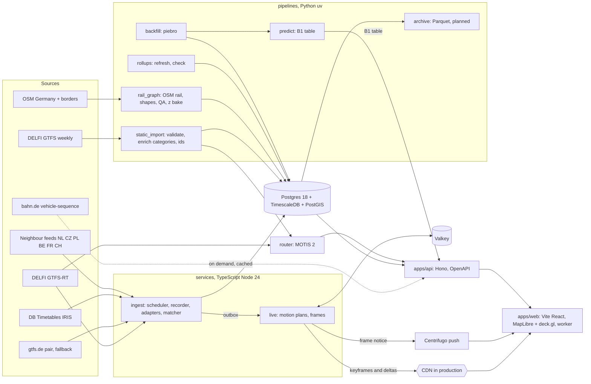

# Architecture

How the product works. The phase plan is in [PLAN.md](PLAN.md), decisions with their reasons in [adr/](adr/),
sources and licences in [data-sources.md](data-sources.md), design in [../DESIGN.md](../DESIGN.md). Facts here
come from research on 2026-10-23; versions were current on that date and are pinned at scaffold time.

## 1. The core idea

No open source publishes measured GPS positions for German trains (all feeds tested carry TripUpdates only).
Every serious live map (geOps, Transitous, Mini Tokyo 3D) computes positions from the timetable plus realtime
delays along track geometry. We do the same, and do it better than the reference site:

1. Every trip pattern gets a **shape matched to OSM rail**, with cumulative distance and baked elevation.
2. The server turns timetable plus realtime predictions into a **motion plan** per running trip: stop positions
   along the shape and predicted times.
3. The client evaluates each plan in **1D arc length** along the shape, so a train can never leave the track,
   and blends new data in by changing speed, never by jumping or reversing.



## 2. Components

Paths that do not exist yet carry the work package that creates them.

| Component | Path | Language | Job |
| --- | --- | --- | --- |
| Web client | `apps/web` | TS, React 19, Vite | map, train and station cards, statistics panel, journey planner, legal and credits pages, worker that evaluates motion plans and places the 3D cars, i18n EN/DE/PL |
| API | `apps/api` | TS, Hono | REST with OpenAPI 3.1 from zod for every route: journeys, journey punctuality, router health, search, stations, statistics (segment profile included), train detail with vehicle identity, photo and forecast, live keys, vehicle photos, data status (`apps/api/README.md`) |
| Ingest | `services/ingest` | TS | poll sources, record raw payloads, parse with pure adapters, match to trip instances, idempotent upserts, outbox events |
| Live | `services/live` | TS | build motion plans, publish binary keyframes and deltas, notify clients |
| Router | `services/router` (SP-1, WP-2.5) | MOTIS 2 binary + config | journey planning, boards, trip geometry for cross-checks |
| Static import | `pipelines/static_import` | Python | DELFI download, gtfs-validator, category and operator enrichment, EVA ids, load timetable, export enriched GTFS for MOTIS |
| Rail graph | `pipelines/rail_graph` (SP-3, WP-2.2) | Python | OSM rail extract, graph, shape matching (pfaedle or MOTIS route_shapes, decided by spike SP-3), QA gate, elevation bake, binary shape packs |
| Geo base | `pipelines/geo_base` | Python | Germany mask, Länder polygons and focus masks (BKG VG250), neighbours, label points, border crossing hints; PMTiles builds later |
| Rollups | `pipelines/rollups` (WP-2.7) | Python | Land areas, refresh and policy control, the recomputation check of the continuous aggregates |
| Backfill | `pipelines/backfill` (WP-7.1) | Python | piebro months converted to stop events, runs and legs, loaded per service day ([history.md](history.md)) |
| Predictions | `pipelines/predict` (WP-7.5) | Python | B1 quantile table the API serves, its backtest against B0, the live shadow check ([predictions.md](predictions.md)) |
| Catalogue | `pipelines/catalog` (WP-6.1) | Python | loads `catalog/` (operators, series, liveries, fleet rules, photos), generates the fleet rules of a timetable year, coverage reports |
| Archive, ML | (M10, M11) | Python | Parquet archive and the B2 delay model, planned |
| Pipeline helpers | `pipelines/common` | Python | project paths, outbound User-Agent shared with the TS side |
| Vehicle forge | `tools/trainforge` (WP-5.1) | TS | parametric glTF generator for train series from `catalog/vehicles.yaml`; the web app serves its output at `/trains/` (section 8.4) |
| Photo review | `tools/photo-review` (WP-6.3) | Python | local page to approve or reject Commons photo candidates into `catalog/photos.yaml` |
| Shared | `packages/{schema,live-frame,geo,db,i18n,ui,config}` | TS | contracts, frame codec, linear referencing, migrations and types, messages, design system, tooling config and secret rule tests |
| Spikes | `spikes/*` | TS | time-boxed measurements (SP-4 render performance), linted and tested in CI, not product code |
| Infra | `infra/` (WP-1.2, production WP-10.1) | Compose, Caddy, Grafana | the local stack; the production overlay `compose.production.yaml` with `production/`, prepared and not deployed |
| Scripts | `scripts/` | Bash, Node | key checks (`check-keys.sh`), staged secret scan, gitleaks rule fixtures |

## 3. Data sources (summary)

Full list, licences and attribution texts: [data-sources.md](data-sources.md).

| Need | Primary | Fallback |
| --- | --- | --- |
| Timetable with train numbers and route types | DELFI national GTFS (weekly, CC BY 4.0, keyless) | gtfs.de static (no shapes, no train numbers) |
| Realtime delays, cancellations, platforms | DELFI GTFS-RT via the de-incremented community mirror, official Mobilithek delivery later | gtfs.de RT (needs gtfs.de static ids) |
| Regional supplements | VBB GTFS-RT, VBN GTFS-RT | DELFI covers both regions |
| DB station detail and long-distance validation | DB Timetables (IRIS), 60 calls per minute | piebro dataset |
| Station master data, lifts | DB StaDa, FaSta | DELFI stops |
| Vehicle formation (DB long distance) | bahn.de vehicle-sequence, unofficial, on demand, cached | fleet rules table |
| Foreign trains near borders | NL (OVapi), CZ (CZPTT), PL, BE (SNCB), FR (SNCF), CH (key) | timetable-only positions |
| Track geometry | OSM Germany (Geofabrik), rail ways only | MOTIS segment polylines |
| History bootstrap | piebro/deutsche-bahn-data (CC BY 4.0) | Bahn-Vorhersage dataset (ODbL, Mobilithek login) |

## 4. Canonical data model

Postgres 18 + TimescaleDB 2.31 + PostGIS 3.6, migrations as plain SQL in `packages/db`. Hypertables marked (H).

| Table | Key | Content |
| --- | --- | --- |
| `source`, `ingest_run`, `raw_object` | id | provenance: every observation points to the raw payload it came from |
| `operator`, `verbund`, `category` | code | catalog joins; `category` holds our canonical codes (section 9) |
| `stop_place`, `stop_point`, `id_map` | DHID, EVA, IFOPT, UIC | stations and platforms, all source ids mapped to one canonical id; a station keeps its stop place across weekly feed versions (`pipelines/static_import/README.md`, One stop place per station across versions) |
| `stop_place_display_name`, `stop_place_search_name` | stop place | the name shown, naming its town, and the other names search finds a place by (migrations 0055 and 0092) |
| `feed_version`, `route`, `trip_pattern`, `trip_pattern_stop`, `trip`, `stop_time`, `service_calendar`, `service_calendar_date` | (feed version, GTFS key) | timetable structure per weekly feed version (WP-2.1, trains only so far); times as seconds from noon minus 12 h of the service day, so a trip can run past 24 h and "trips on day D" read service days D and D−1 (needs a test on a DST day such as 2026-10-25); `trip_pattern` keeps the DELFI shape key and later links to `shape_pattern` |
| `trip_instance` | UUIDv5(service_date, operator, train number, origin, scheduled origin departure) | one real run; unmatched source records go to `match_backlog`, never dropped; a backfilled run has `backfill` set and no timetable link (migration 0087) |
| `stop_event` (H) | (trip_instance, seq) | scheduled, predicted and final arrival and departure, platform scheduled and actual, cancelled, additional, quality (`live`, `carried`, or `final_only` for the backfill), last update |
| `stop_event_forecast` (H) | (trip_instance, seq, observed_at) | every change of prediction; required for ML from day one |
| `segment_obs` (H) | (service_date, trip_instance, seq) | written when the train reaches the next stop: delays, delay gain, run times, dwell, distance, implied speed |
| `shape_pattern`, `trip_pattern_shape`, `shape_stub`, `shape_registry` | hash, shape number | LineStringZM (M = metres, Z = metres above sea), stop arc positions, QA status, the shape of each pattern, track beyond the shape ends, shape number epochs |
| `vehicle_series`, `livery`, `fleet_rule`, `formation_observation`, `vehicle_photo` | series, rule, (source, day, train number), photo | the catalogue's series and liveries, fleet rules for layers L2 to L4 (0086), coach sequence results for L0 and L1 (0085, day index 0091), approved Commons photos with their credit (0089) |
| `alert_message`, `alert_scope` | (source, key, content hash) | each version of a service alert and the trips and stop places it names (migration 0041) |
| `event` (H) | id | append-only outbox: TripDelayChanged, TripCancelled, PlatformChanged, FeedStale, IngestRunCompleted |
| rollups | continuous aggregates | level 1 `stat_stop`, `stat_segment` (one source per stop); level 2 `station_day`, `station_hour`, `train_day`, `line_day`, `segment_day`; level 3 `land_category_day`, `land_category_hour` per Land and category (0066); views `land_day`, `land_hour` over `station_day` and `stop_place_land` (BKG VG250), kept for the recomputation check; fixed-bin histograms (WP-2.7, `pipelines/rollups/README.md`) |

Segment metrics (segment = consecutive served stops i to i+1 of one trip instance): `dep_delay_from`,
`arr_delay_to`, `delay_gain = arr_delay_to − dep_delay_from`, `run_sched`, `run_act`, `dwell_delay`,
`speed_sched`, `speed_impl` (distance along our shape over run time; an average, not a top speed). Histogram
bins (table `stat_bin`): delay −30 to −5 min, −5 to 0, one-minute bins to 16, 16–20, five-minute bins to 60,
60–90, 90–120, over 120; gain and speed have their own bins. One-minute bins run to 16 minutes so DB's 5:59 and
15:59 rules fall on bin edges; any period merges exactly and percentiles need no raw scan.

Rollups take each stop from one source (a live final before a carried one, then the source rank of D-041), so two
feeds never double count. The stop delay is the arrival delay where a scheduled arrival exists, else the departure
delay. Punctuality follows DB's definition: a stop is punctual when the train exceeds its scheduled arrival by less
than 6 minutes (less than 16 for the second figure), counted at arrival stops without the origin, cancelled stops
excluded ([DB Pünktlichkeitswerte](https://www.deutschebahn.com/de/konzern/konzernprofil/zahlen_fakten/puenktlichkeitswerte-6878476));
figures for Germany leave out stops abroad (`land_code = 'foreign'`). These are the `_arr` counts of the level-2
rollups, so our numbers can be validated against DB's monthly figures. Statistics are as fresh as the refresh
policy schedule (level 1 every 30 minutes, level 2 five to nine minutes later, so up to about 40 minutes
behind); reads see materialised rows only. Level 2 refreshes a week ahead so every level-1 write is
logged for it whatever order the jobs run in, while level 2 has run within the last five days (migration 0064);
policies paused for longer are resumed with `gerlines-rollups resume`, which moves the level-2 threshold first. The rollups are rebuildable from the source
tables, so backups cover the source tables and not continuous WAL of rollup rewrites.

## 5. Ingest

- One adapter per source, a pure function `(payload, fetchedAt, staticContext) → canonical events`. No clock
  reads inside adapters; a `Clock` is injected.
- Scheduler per source: UTC slots with jitter, conditional GET, exponential backoff, `Retry-After`, a token bucket
  matching the provider limit, redirects checked against a per-source allowlist; one recorder process per data folder
  holds a heartbeat lock file.
- Recorder (`services/ingest`, WP-1.3, decision D-027) stores every payload byte for byte: per source and UTC hour one
  segment `data/recordings/<source>/<UTC date>/<HH>.seg.zst` of zstd frames, each payload a patch against the previous
  one (keyframe after a restart), with a sidecar line per fetch (URL without secrets, status, headers subset, sha256,
  bytes, timing, GTFS-RT header summary) as the commit point; static files are stored whole. The files are the source
  of truth; `raw_object`, `raw_object_segment` and `recording_gap` index them and `reindex` rebuilds them. Gaps are
  recorded per source; `backfill-recent` fills DELFI minutes from the traines mirror's day folders, older days are
  streamed from the `tar.br` day archives by `backfill-archive`, which also writes a sha256 manifest. Retention keeps
  3 days plus golden days and deletes only files whose every payload is in a public archive or in `rt_payload`;
  `retention.jsonl` explains every deletion. A mode file switches the running recorder between full, travel and
  paused. About 4 to 5 GB per weekday for the realtime feeds. R2 in production.
- Upserts converge under duplicates and reordering (`ON CONFLICT … WHERE excluded.observed_at > t.observed_at`).
  Forecast rows are written only when a value changes.
- Realtime processor (`services/ingest/src/realtime`, WP-2.3 and WP-2.3b, migrations 0030 and 0041) folds recorded
  payloads into `trip_instance`, `stop_event`, `stop_event_forecast` and `segment_obs`, either as a replay or live on
  the recordings' tail (one writer, checkpoints for restart, heap 1.5 GB and container 2.5 GB in the Compose
  `realtime` profile). DELFI comes from Mobilithek with the traines mirror as fallback, gtfs.de as a second source.
  A late payload (a backfill or a delayed fallback) rebuilds its days in 5 s slices beside the tail: rows from the
  first changed payload on are staged in the unlogged `rt_rebuild_*` tables, and only the rows that differ are swapped
  in one transaction (about 18 s for two DELFI days); readers following `rt_payload` by `processed_at` see the late
  payloads at the swap. `check` reports data invariants (must be 0) and quality counts, among them feeds rejected
  because the source sent them broken.
- DB Timetables (IRIS) as the realtime source `db-iris` (`services/ingest/src/realtime/iris.ts`): the plan and
  change answers of the long-distance station cover fold under one logical source, matched by train number and planned
  time or by planned stops, for `hsr`, `ld` and `night` runs only (others are out of scope as
  `iris_not_long_distance`), ranked by the D-041 source priority for `hsr` and `ld`. An answer waits 30 s on the
  processing clock before it folds (`IRIS_HOLD_MS`), the plan and change books are part of the checkpoint, and a positive
  delay at the first stop an answer names is carried back, as propagated, to the unreported stops before it. The recorder's IRIS lane is off
  (`RECORDER_DB_APIS` unset), so no IRIS rows are folded yet; `services/ingest/README.md` names the switch.
- The recorder starts in the first build wave, before anything else depends on it, because history needs weeks of
  data (stop events, forecast snapshots) before statistics and ML become meaningful.
- Replayer: streams a recorded day through the same code with a virtual clock at N times real time into a
  throwaway database. Used for tests, demos and debugging.

## 6. Static pipelines

1. **Timetable import** (weekly, Monday; `pipelines/static_import`): download DELFI GTFS (about 515 MB), validate
   with MobilityData gtfs-validator (the full feed needs more than a 9 GiB JVM heap for `stop_times.txt`, so the
   train subset is validated routinely), map route types and line names to canonical categories (section 9), attach operators,
   join EVA numbers (community-enriched copy or StaDa), load into Postgres, write an enriched GTFS for MOTIS. After
   each load, `display-names` gives every stop place a display name that names its town (normalised DELFI name, else
   DB StaDa, else the EVA copy, else the BKG VG250 municipality put first; read by search, the train detail, the
   station card and the journey answers; the other names go to `stop_place_search_name` for search) and `products` the product (ICE, IC, RE) of the trains whose product is known.
   A station keeps one stop place across weekly versions: a place DELFI renumbered or gave a new id gets the stored
   identity of the same station (district twin, shared EVA number within 1 km, same name within 100 m), reviewed
   decisions come from `place-identity-overrides.csv`, and every reuse and fold is listed in `place-identity.csv`
   (`pipelines/static_import/README.md`, One stop place per station across versions).
2. **Rail graph and shapes** (weekly or on timetable change): Geofabrik `germany-latest.osm.pbf` (and DACH or
   neighbour extracts for cross-border lines) filtered to `railway=rail|light_rail|subway|tram|narrow_gauge` plus
   stations; graph with usage, service, maxspeed, electrified, bridge, tunnel, layer. Shapes per trip pattern from
   pfaedle (`-m rail`) or MOTIS `route_shapes`; spike SP-3 picks the better one on a QA set. QA gate: reject a
   shape whose stop projection is over 80 m away or whose detour ratio is implausible; rejected patterns fall back
   to the second method, then to straight stop-to-stop lines flagged `low_quality`.
3. **Elevation bake**: Z per vertex from the Mapterhorn DEM at z12, linear interpolation across bridges, tunnel
   flags kept (trains in tunnels render as dimmed ghosts).
4. **Shape packs** for the client: per shape, delta-encoded Int32 Web Mercator centimetres, Float32 z, the arc
   length M per vertex (flat WGS84 geodesic metres as the bake stores them, so the client never measures 3D length
   against stop arcs), stop arc positions and tunnel spans (`packages/live-frame` FORMAT.md §5). Built by
   `live packs build` per timetable version and named by shape number within a shape epoch: the highest epoch in
   `shape_registry`, which is append only (migration 0057), so the packs of an epoch never change. A new set of shapes
   is a new epoch with its own packs; a build that passes the geometry gate ends with `s/<epoch>/complete.json`
   (section 7; steps in [development.md](development.md), Shape epochs and packs).
5. **Geo base**: Germany mask (world minus Germany), 16 Länder polygons and one world-minus-Land mask per Land for
   focus mode, neighbour labels and first border crossing hints, from BKG VG250 (DL-DE BY 2.0) and Natural Earth
   (public domain); two levels (national about 300 m, focus about 100 m) simplified with shared borders kept, and
   German islands such as Helgoland kept at every level.

## 7. Live engine and transport

- `live` keeps the set of running and soon-starting trip instances. For each it holds a motion plan: shape hash,
  stop arc positions, predicted departure and arrival per stop, category, flags (realtime or timetable only,
  cancelled, tunnel spans), current delay.
- Realtime input: at start `live` reads a snapshot of `stop_event_forecast` (the newest row per stop and source for
  yesterday, today and tomorrow), then follows `rt_payload` by
  `processed_at` (monotone, since the processor is the only writer and stamps late payloads with their swap) and reads
  each payload's rows under its `fold_source_id`. A source counts as reporting a train while
  `trip_instance_source.last_observed_at` moves, even when its predictions do not change. On a `realtime_rebuild`
  notice it reloads the rebuilt days' rows of the trains it holds; after a lost listener connection, all of them. A
  reload runs off the tick (one at a time) and its batches apply on later ticks, with the rows followed meanwhile on
  top, so a reload through compressed chunks never holds a frame.
- Rows of another timetable version (a source folds on the version its payload names, the engine may still run the
  previous one): every source's rows go onto the engine's run by one monotone alignment over station agreement and
  scheduled-time distance (`services/live/src/plan/place-rows.ts`); a renamed station counts only within 150 m;
  a row that fits no stop is dropped and only that stop loses its realtime. The train detail places rows with the same
  function, so map and card agree ([runbooks/delfi-rollover.md](runbooks/delfi-rollover.md), Realtime while the
  engine stays on O).
- Frames: a little-endian struct-of-arrays binary format (`packages/live-frame`) with magic, version, sequence,
  timetable version. Keyframe every 30 s, delta every 2 to 5 s with changed plans only. A full keyframe for about
  3,000 trips is roughly 40 to 60 KB compressed. Since format 1.3 each trip also carries its vehicle series,
  operator and units (about 3 KB more per keyframe of 2,769 trips, brotli 11).
- Frames chain without gaps: every sequence has a delta whose base is the sequence before, keyframe k equals the
  state after delta k, and a client drops frames of another timetable version (FORMAT.md §3, §4). Shapes are named by a
  stable number in a registry epoch carried in the frame header, or by a content hash prefix.
- Transport: frames are immutable objects (`/live/v1/k/<seq>.bin`, `/live/v1/d/<seq>.bin`, shape packs at
  `/live/v1/s/<epoch>/<number>.bin`), published pre-compressed (brotli 11 with a gzip copy), plus a tiny
  `/live/v1/head`. Locally `live` serves them directly; in production they sit behind the Cloudflare CDN. `live run`
  starts ticking only once the packs of the current epoch are marked complete in its directory
  (`s/<epoch>/complete.json`, written last by a full `packs build` that passed its gate; until then it answers 503 and
  logs; build steps in `infra/README.md`), and a restored chain of another epoch starts a new chain. `live run`
  answers HTTP on a worker thread of its own and the head from memory: the engine posts each head's bytes to it after
  writing the head file and before the notice, so no request waits for a tick or for a file read behind the
  compression of frames. Per-train channels carry detail updates for the open train card.
- Pack sets (FORMAT.md 4.2): two minutes before each 10 minute window `live run` bundles every shape the frames
  will name until the window ends into a base set (parts of about 150,000 vertices of nearby shapes, 13
  nationally) and the shapes new since the previous window into an increment, each a compact 1.4 pack (M coded as the
  residual against the ground distance predicted from x and y, FORMAT.md 5.4) re-encoded from the gated single packs,
  and names them in the head. A joining client reads the base parts one after the other instead of about 2,000
  single packs, a running one one increment per window; single packs stay for what a set lacks, for older clients
  and for playback. Sets are built on a worker thread of their own and staged before they move into place;
  `LIVE_PACK_SETS` set to 0, false, off or no turns them off.
- Push notices: after each head that names a new sequence, keyframe or timetable version the engine publishes
  `{seq, keyframe, oldest, tv}` to `live:frames` on Centrifugo. The web worker subscribes over
  `/connection/websocket` (`apps/web/src/live/push-channel.ts`) and reads `head` when a notice names one it does not
  hold, at once after (re)subscribing, and after 10 s without a notice. It polls `head` every second, as before,
  while the channel is down or up but silent (a 10 s read found frames no notice announced) until the next notice.
  A head older than its notice (an edge that still caches the last one) is read again after 250 ms, up to four times.
  The socket reconnects after 1 s doubling to 60 s with jitter, and closes while the page is hidden or a playback
  runs. Production and `?probe` pages use our own `/connection/websocket`; a development page needs `?push=<url>`
  (the dev server has no push route); a replay has none. The production Centrifugo admits anonymous connections and
  anonymous subscriptions to the `live` namespace only; nobody publishes, and presence and history are off
  ([deploy runbook](runbooks/deploy.md)). A tab shown again connects at once but keeps its grown reconnect wait for a
  minute. `live run`'s `/healthz` fails after 30 s without an engine tick.
- Train detail (D-038): the tick hands changed and removed trains to its detail port without waiting; a background
  dispatcher merges updates while one publishes and sends an empty update after 10 s without one, so the
  confirmation time moves on a quiet night. `TrainDetailPublisher` rebuilds each changed train from the database
  (`stop_event` on the system clock, `stop_event_forecast` as of the instant on a replay clock), writes it to Valkey
  (`live:train:<id>`, until 15 min after the run ends), confirms the tick and pushes the detail to `train:<id>` within
  a 2 s budget. The API serves `GET /api/v1/trains/{id}` from Valkey and answers 503 when the confirmation is older
  than 30 s. A failed write keeps its trains for the next update and rejects, so the dispatcher backs off; a train
  that left more than 15 min after its run's end gets no detail; a written progress never falls behind what the
  previous detail could have served (process memory only, so a restart may step a card back once). The engine's own
  progress never goes back either (a reached stop stays reached, except one the source then cancels), also
  in process memory: `render --detail-check --restart-at` counts the steps a restart causes. `live run`
  publishes details whenever it has Valkey, on a Valkey connection and a 2-connection database pool of their own;
  `LIVE_DETAIL=0` switches them off. The head delay (`delaySeconds`) agrees with the stop rows: it is the
  chosen source's prediction at the stop the train leaves or reaches next (`delayBasis: "stop"`), and the tick's own
  delay only when that stop has no prediction (`delayBasis: "current"`, which the card writes as Now +1 min). The
  tick's delay is the one its motion plan drew with, so it can lag a newer prediction by minutes.
- Platforms: ingest stores every platform as the source gave it (`stop_point.platform_code`, `stop_event`
  platform columns, the `PlatformChanged` payload), which keeps the provenance. One pure function,
  `normalizePlatform` in `@gerlines/schema/platform`, reads them as on the station sign wherever they are shown: the
  live detail builder, the API's served detail (also details an older writer stored) and MOTIS journey tracks. It
  drops the word for platform or track in German and the neighbours' languages ("Gl. 1",
  "Bstg. 2", "Pos. 3", "Voie 4", "tor 5"), line marks and the platform height suffix, writes a pair of neighbouring
  tracks with a hyphen ("9-10"), turns the measured stop codes into null and keeps any other value as given. Given the
  stop's DHID (the live detail passes the stop place's, the journeys the MOTIS stop id), it also turns into null the
  stop numbers two regions publish as platforms: the VRS districts (Köln Hbf 83 to 91, Bonn Hbf 78 to 82)
  from 70 up, the OWL districts (Bielefeld Hbf 91 for track 1) from 90 up. DB IRIS station plans for the same trains
  agreed with none of them (Köln Hbf 0 of 39, Köln Messe/Deutz 0 of 275, Bielefeld Hbf 0 of 98), so these stops show
  no track rather than a code; the realtime feeds name the same stop points and so the same numbers. A change
  keeps both values, compared after normalising, so a different spelling of the same track is no change.
- Playback (WP-7.6, proposed in [ADR-0014](adr/0014-playback-windows-from-history.md)): past UTC hours, up to 7 days
  back and 30 min after their end, are rendered once by `live playback render` (a separate process) with the
  engine on a virtual clock over history as of each tick, at a delta every 10 s and a keyframe every 300 s, and
  kept on disk under a byte budget as brotli and gzip copies. `/playback/v1/*` serves the window list, an index with
  the first head of each state, the head of any instant and the keyframes and deltas under a revision hash, in the
  live format for the same client decoder; `live run` mounts these routes read only when `LIVE_PLAYBACK_DIR` is set.
  Each revision has its own directory and the window's index is replaced by a rename, so a revision's bytes never
  change; each timetable version plays from its load time. One niced job per cache holds a lock. No public request
  starts a render. Speed, pause and seek stay in the client.
- Data status (WP-9.7a): `GET /api/v1/status` tells a viewer how fresh each source of the map is. The API reads the
  rows the recorder writes (newest `raw_object` per recorder source, a running `record` run in `ingest_run`) and the
  live engine's Valkey keys (the confirmed tick, the newest payload per source it folded), one answer per 30 s for
  all clients, and judges each source by the recorder's staleness threshold: ok, stale, down (an hour without new
  data, or not fetched), not recorded. It is an API route and not a head field: every client reads the head
  often from the CDN, and the live engine does not know the recorder's fetches. The live bar's status
  dot opens a popover with the live map's frame age and the sources by kind; it loads, and starts reading, on the
  first press ([apps/api README](../apps/api/README.md), Data status).
- Rail only needs no viewport tiling. If urban transit is added (tens of thousands of vehicles), frames split by
  Land or z6 tile.

## 8. Client motion and rendering

### 8.1 Motion (worker)

Everything runs in arc length `s` along the trip's own shape, so `position = shape(s)` is always on the track. The
kernel is `packages/geo` (spike SP-6, decisions D-017); this is its contract.

```
plan:      stops with s (clamped to [0, shape length], counted), predicted arrival and departure, a stable shape id;
           arrivals earlier than the train can make (speed limit, accelerations raised to at most 1.0 m/s²) move
           later and are counted in adjustments; a speed limit that is not finite and above 0 counts as missing
per leg k: trapezoid speed profile fitted to L = s1 − s0 and T = tArr − tDep, triangle when the leg is short,
           vmax = min(category max, speed limit), the limit yields only when the timetable's average speed needs it
target(t): dwell at s_k until the departure, the profile inside a leg, s_end after the last stop

every frame, in substeps of at most 0.05 s:
  e      = target(t) − disp.s                                both at the same instant
  ff     = (target(t + h) − target(t)) / h                   mean target speed over the step
  catch  = min(|e| / 4 s, sqrt(2 · 0.96 m/s² · |e|))         linear below about 31 m, never overshoots
  vCmd   = clamp(ff + sign(e) · catch, 0, 1.5 · vTarget + 8 m/s)     never negative, so never backwards
  vCmd   = min(vCmd, sqrt(2 · 1.0 m/s² · (cap − disp.s)))    brakes into the next stop, cap = that stop's s
  disp.v += clamp(vCmd − disp.v, −1.2 · h, +1.2 · h)         visual acceleration limit
  disp.s  = min(disp.s + disp.v · h, cap)
  position, yaw, pitch from the shape at disp.s; each car placed by its two bogie points (Jacobs bogies shared)
crossfade (0.25 s out in wall-clock time, swap while invisible, 0.25 s in): |e| > 3 km, a new shape, the display
  already more than 25 m past the stop the target heads to, a frame gap over 5 s, or a non-finite state; a fade-out
  that ends inside a frame ends that frame at opacity 0
a train resting on a resting target is skipped until its next departure
on a measured fix (foreign feeds with positions, not built yet): project onto the shape within ±2 km of the
  estimate, alpha-beta filter, store the correction as extra delay
```

- Open (WP-3.2): a delay that arrives after the departure only moves the arrival, so a display ahead of its target
  waits (up to 580 s in the ICE 379 replay). Motion plans need a rule: a hold point, or keep cruising and absorb the
  delay at the next stop. Every plan stop is a full stop, so stops the train passes through stay out of the plan.
- Frame continuity is judged by `ContinuityMeter`: jumps (displacement ratio above 2), stalls (below 0.5),
  backward steps, swaps drawn above opacity 0, steps faster than 150 m/s and positions off the shape, at 60 fps, at a
  variable frame rate and at 10x replay (fades take a `timeScale`).
- One worker owns shapes (40-byte vertex records, `s` starting at 0) and plan state in `MotionFleet` (typed columns,
  slots ordered by shape), writes Float32 positions, angles and colours for visible trips plus a 20 % margin
  (`writeHeadSlots`), and transfers them each frame. No SharedArrayBuffer (COOP and COEP would break third-party
  tiles). Positions are Web Mercator offsets from an origin near the camera; for deck.gl metre offsets multiply by
  cos(latitude of the origin) and move the origin with the camera (the error grows with the square of the distance).
- Stationary trains take their heading from the track tangent, never from noise.
- Each card shows provenance: live prediction, estimated between reports, or timetable only, with data age.
- The speed on the card (SC-4) is computed in the client, never sent by the server: `MotionFleet.planSpeed`
  gives the speed along the shape of the selected train's motion plan at the display clock (the profile speed inside a
  leg, zero before the first departure and in a dwell, none from the last arrival on), and the worker adds it to the
  selection update it already sends once a second (`speedMps` in `LiveSelectionInfo`). It is the speed of the plan the
  marker follows, so no distance over time, no heading and no guess is involved; the display's own speed differs from
  it only while it catches up with a new plan. A playback evaluates the plan at its virtual clock in plan seconds, so
  10x plays the same number as 1x, and a paused playback keeps the value of the paused instant. The card rounds to
  5 km/h, labels it an estimate and names its basis (timetable and the latest realtime report, or timetable only).

### 8.2 Levels of detail

| Zoom | Shows | deck.gl layer |
| --- | --- | --- |
| under 9 | dot in category colour, selected train with a halo | ScatterplotLayer, binary attributes |
| 9 to 12.5 | oriented icon, label on hover and selection | IconLayer (mask icons) + TextLayer |
| 12.5 to 14.5 | track slice: the shape from s − train length to s, true length, follows curves | PathLayer, width in metres with a pixel minimum |
| a car at least 3.5 px wide (about 16 and closer) | 3D cars, one instance per car placed by bogies, LOD0 at 17, LOD1 from 15.5, one level coarser beyond the view's half diagonal | SimpleMeshLayer per mesh and LOD |

Built on `main`: dots, chevrons (crossfading from zoom 9.5 to 10.5) and the 3D cars (section 8.4); the track slice
tier is planned (WP-3.4), so trains stay chevrons until the cars take over. The car tier was planned from zoom 14.5,
where a car is about 1.4 px wide; it now starts by the on-screen width of a car
([ADR-0013](adr/0013-3d-car-hand-over-by-screen-width.md)).

Crossfade over half a zoom level between tiers. The selected train always gets the highest tier it can and the
reserved selection colour; its route ahead draws itself; other trains dim. Camera follow is an explicit action.

The signature moment (WP-5.4, `apps/web/src/signature`): a selection, from the map, the list, the search or a deep link,
flies the camera to the train and tilts it. `planSelection` gives the move from the distance in screens at the closer
zoom: within 1.2 screens `easeTo`, beyond it `flyTo` on an arc (curve 1.3, never zooming out past 4); 0.7 to 1.4 s with
the design curve `cubic-bezier(.2,.7,.2,1)`; zoom at least 11.5 and pitch 55 (60 is the limit; constants in
`map/camera-constants.ts`); the bearing stays 0 and the keyboard cannot rotate. Dark, Light and Satellite have a pitch
limit of 0, so `SelectionCamera` lifts it to 60 while a selection holds the tilt and drops it when the move that
untilts the map ends, whatever pitch that move ended at (a drag can interrupt it); Terrain 3D tilts back to the relief's
own pitch, and `ReliefControl` leaves a held tilt alone. The map stays north up (the chevrons and the soft bounds assume
it); a tilted north- or southbound train sits off the middle of the free area (`chasePadding`) so the route ahead keeps
room. `SelectionMoment` orders one selection: it flies when the first frame of the selected train (its id, not a frame
of the train before) arrives, and arms the draw once the route of that frame's leg is known. The route ahead draws
along the shape in arc length: `RouteReveal` measures the XYZ path of the route ahead in metres once per path and
returns the prefix up to the drawn length with the end point interpolated on the segment; `RouteDraw` runs 600 ms
linear from 45 % into the flight, over the distance the screen shows at the end of the flight (1.5 screen diagonals),
and the part beyond that joins when the draw ends. Route, a cut and the end of the selection leave the route whole.
Reduced motion cuts the camera (`jumpTo`, 180 ms opacity fade in unless the camera is already there), shows the route
whole and tilts back by a cut.

Spike SP-4 (D-018) kept these thresholds and adds count caps after culling: dots and icons 15,000 trains, track slices
1,500, cars 300 trains (about 3,000 instances) with a hard cap of 600. The first limit to break is the worker's update
rate, not the frame rate: on a 4x slower CPU the update rate fell below 60 per second from about 25,000 advanced trains.
So the worker advances trains in view plus a margin every frame and the rest at a low rate, keeps two requests in
flight, and the HUD reports map draws per second, not only frame times. No GPU motion path for v1.

### 8.3 Map

- MapLibre GL JS 6.x (ESM only, WebGL2) with deck.gl 9.4 through `@deck.gl/maplibre` in interleaved mode, train
  layers placed below labels with `beforeId`. WebGPU is not production-ready in either library; revisit in 2027.
- Without a GPU (software GL): every deck.gl draw in interleaved mode repaints the whole MapLibre style, and
  SwiftShader pays for each of its triangles. Three rules keep that cheap without changing a pixel anyone can tell (at
  most 0.016 % of pixels differ on the screens, against the WP-9.3 limit of 0.4 %).
  - `RepaintGate` lets `receiveFrame` push a frame into the layers only when a train is 0.5 screen pixels from where it
    was last drawn (distance in Mercator pixels, height counted as the pixels it spans, scaled by the finer scale of the
    nearest row of a pitched view), a chevron tip has moved 0.5 px (turns count only while chevrons are drawn), colours,
    sizes, ids or groups changed, the view, canvas size or padding changed, a pass over the bridges finished with other
    stretches, a train is selected, cars are drawn, or 2 s have passed. The worker keeps evaluating every frame, and the
    comparison is against the last frame drawn, so slow movement adds up until it shows. `?probe=1&repaint=always`
    turns the gate off, for the fps probes.
  - Thin tile lines (state and country borders, coast, national outline, paths, motorways, minor roads, rails) join
    mitred below zoom 10 (`THIN_LINE_JOIN`) because the tiles carry several vertices per pixel there and every round
    join adds triangles.
  - The national mask reads at the default tolerance of 0.375 px (Land masks stay exact) and skips the fill outline pass
    below zoom 11 on the flat styles; the national outline and the multisampled canvas cover its edge there, while
    beyond zoom 11 and on the relief (render-to-texture targets are not multisampled) the pass stays.
- deck.gl layers are not draped on MapLibre terrain: train z comes from the baked shape z times the terrain
  exaggeration (1.5, `TERRAIN_EXAGGERATION`). The worker writes it into the frame (`POSITION_STRIDE` 3 numbers per
  train, the selected train's height, the route heights, every car pivot), zero on a flat map, and the page tells it
  the factor (`elevation` message, owned by `ReliefControl`). deck.gl 9.4's MapLibre overlay follows the terrain's
  centre elevation, so picking works on the relief. Markers rise above the surface by `markerLiftM`: 3 screen pixels,
  stretched by 1/cos(pitch) and never under 30 m below zoom 13 (fading to 0 at 15), because the terrain mesh follows
  the DEM (zoom 12) coarsely; cars rise 0.5 m. The selected marker and the route ignore the depth test and do not write
  depth on terrain. Where something stands in front of a chevron (a ridge, a tunnel mountain, an extruded station hall)
  a second, faint chevron layer (`GHOST_OPACITY` 0.4, `depthCompare: greater`) keeps the train visible, so a train is
  never lost and a click on it is a click on what is drawn. Style rail lines are draped by MapLibre while a train on a
  bridge follows the straight line between two shape vertices, so the worker sends the vertices of every shape that runs through the view and half a screen beyond it, with or
  without a train on it (`deckWindows`, from zoom 12, scanned again when the view nears the edge of the scanned box
  and sent only when the result differs, at most 150,000 vertices, nearest shapes to the view centre first, each message with fresh buffers because the worker
  transfers them). The page (`BridgeDeck`) measures each segment once against the DEM of the tile drawn at its place
  (only segments inside `map.getBounds()`, at most 4,000 terrain lookups a frame so a new deck is spread over several frames; `getDrawnElevationForLngLat(.., true)`; a parent tile's DEM can be hundreds of metres off, so nothing is measured
  or remembered before the tile's own loads), keeps results in two generations under numeric keys, tries unmeasured
  segments again after a terrain tile loaded or the view moved (at most once a second) and draws the stretches where
  the line runs more than 12 m above the rendered terrain as a deck line (rail colour with a casing) under the
  markers, each stretch brought down to the terrain by one more vertex at both ends. The layers get the same data
  array until the stretches or the lift (to half a metre) change. The lift of a stretch grows from its joint with the rail by one metre per 20 m of track (`LIFT_RAMP_M_PER_M`), so the line leaves the rail on a 5 % grade and no step shows at an abutment. The packs carry tunnel spans only, no bridge spans,
  so the terrain is the judge. In Terrain 3D the style rail is darker (`map-label`) and wider from zoom 11, a rail
  with `brunnel=bridge` is drawn at 50 % under the deck line from zoom 12 (below it the bridge keeps full strength, as no deck line exists there; at 30 % the rail of a short overpass, which has no deck line, read as a break) and a rail with `brunnel=tunnel` at 40 % and dashed, so
  no second track runs into a gorge and no track climbs a ridge. Chevrons do not write depth, so a ghost is judged
  against the relief and the buildings only.
- 3D buildings: one `fill-extrusion` layer (`building_3d`, above the roads, below the mask) from zoom 14.5, height and
  opacity ramp in over one zoom level, only in Terrain 3D (Dark and Light cannot tilt until WP-5.4) and without the
  outlines marked `hide_3d`; the style light intensity is 0.22 so shaded walls stay above #B0ADA6. Device tiers
  (`apps/web/src/map/terrain`): the tier comes from the plain WebGL renderer string, else the unmasked renderer,
  device memory and cores (no network); low starts with relief and buildings off, mid with relief on, high with both on,
  and the user's switches (stored in `localStorage`) win; the buildings switch shows only while the relief is on. 3D
  terrain is the Terrain style's switch; 2D hillshade is always on in that style.
- Styles: dark (default), light, satellite, terrain. All on the OpenMapTiles schema, generated by a style builder
  from DESIGN.md tokens. Development uses OpenFreeMap tiles, VersaTiles satellite and Mapterhorn terrain, all
  keyless; production is planned to serve our own Planetiler PMTiles from R2 (Germany plus neighbours, about 5.5 GB
  to z14, WP-10.1).
- Outside Germany: a world-minus-Germany mask above landuse, roads and buildings but below rail lines, borders and
  labels, so neighbours and cross-border lines stay readable. Soft bounds: a hard `maxBounds` at Germany plus
  about 400 km, an elastic rubber band past Germany plus 60 km through `transformCameraUpdate`, and an ease back
  on release (instant under reduced motion).
- Land focus: swap the mask to world minus the chosen Land, dim the other Länder, `fitBounds` with padding for the
  panel or bottom sheet.
- Labels: per-language `text-field` coalesce (`name:<lang>`, then `name:latin`, then `name`), so a place without a
  translation shows its local name and never a German exonym abroad; switched on locale change with
  `setLayoutProperty` on the name layers (our own style tags them in `metadata`), without reloading the style (spike
  SP-5: about 46 percent of places in the OpenFreeMap tiles have no `name:pl`). The Noto Sans glyph PBFs come from
  OpenFreeMap (`GLYPHS_URL` in `apps/web/src/map/style/build-style.ts`); self-hosting them with the tiles is planned
  for production (WP-10.1).

### 8.4 3D cars (built, WP-5.2)

- Models: `tools/trainforge` writes `dist/` (git-ignored): `manifest.json` (consist with bogie offsets per model),
  `palette.png` (one row per livery) and one meshopt-compressed glTF per car type, bogie and level of detail. The web
  dev and preview servers serve that folder at `/trains/`, and `vite build` copies it into the build output
  (`apps/web/vite/train-models-plugin.ts`); turbo builds the forge before the web app. No model file is in git.
- Loading: from zoom 15.3 the page fetches the manifest, the palette and the meshopt decoder, and each mesh at the
  level of detail a train needs. A failed request is retried after 1 s, doubling up to 1 min (`loadWithRetry`,
  `retryDelayMs`), and reported through `warnCars`, the web app's only console sink. A train keeps its chevron until
  every mesh it needs is loaded.
- Placement, in the worker (`apps/web/src/cars/car-instances.ts`): up to 300 trains nearest the view centre; a train
  is placed only when its whole consist lies on its shape ([ADR-0012](adr/0012-3d-cars-at-shape-ends.md)); each
  bogie pivot is the shape point at its arc length behind the front, each car body sits on the chord between its two
  pivots with that chord's heading and grade (section 8.1). The worker transfers one instance buffer per attribute for
  the whole fleet, each mesh and level of detail in its own range: positions in Float64, deck.gl's 12-float model
  matrices, colour and opacity, livery row, lamp states, selection flag and train key.
- Drawing, on the page (`apps/web/src/cars/car-layers.ts`, `fleet.ts`, `fleet-layer.ts`, `car-paint.ts`): one deck.gl
  layer, `CarFleetLayer` (a `SimpleMeshLayer`), for all cars of a frame (a second one under it for the satellite
  casing). The worker merges the per-mesh instances into one set of arrays (`FleetMerger`, `fleet.ts`; a frame carries
  `fleet`, not `meshes`) with a range per mesh and level of detail; the layer keeps one luma.gl model per mesh whose
  vertex attributes start at its range, so deck.gl updates and draws one layer and uploads one buffer per attribute
  instead of 19 layers. Three things keep the per-frame cost of those models low. The models share one set of
  shader inputs and one uniform store (`shared-uniforms.ts`): the layer sets deck's module props once and writes the
  changed uniform blocks once per frame, where each of the 19 models packed and uploaded the same projection, picking
  and layer values itself. Each mesh keeps its slot in the arrays (`slot-layout.ts`, room of half the count and at least 4,
  doubling when a mesh outgrows its room, packed again only when the arrays hold twice the packed size of the frame
  plus 128), because luma hashes a model's buffer layout
  into its render pipeline cache key: a slot that moved was a new pipeline, and a new pipeline introspects the program,
  which made the longest frames (108 moves in 28 s at the 300 trains stress, 8 with stable slots). And the worker
  counts a statics version (`staticsVersion`: the colour, livery, lamp and selection columns equal the last frame's),
  so the page neither concatenates arrays nor compares those columns (with an epoch, so two workers' versions never
  meet). The layer overrides `_setModelAttributes`, `setShaderModuleProps`, `setTexture`, `finalizeState` and `draw`, and
  reads `state.models`; it also relies on these members, which are not public API of deck.gl 9.4.1 and luma.gl 9.4.2
  (each is pinned by a source check in `fleet-internals.test.ts`): luma `Model._uniformStore`, `Model.bindings` with
  its `<module>Uniforms` keys, the Model constructor keeping a given `shaderInputs` as the same object and not
  adding plugin modules to it, `setShaderInputs` building the store, `predraw` calling `updateShaderInputs` as the only
  uniform write of a draw, `destroy` destroying the store, `UniformStore` with public fields (the silent view is
  `Object.create(store)`), deck `Layer.setShaderModuleProps` looping over `getModels()`, and WebGL
  `writeBufferViaCommandEncoder` writing at once; deck turns float64 attributes into two float32 on the CPU over their
  whole length, so room between slots costs per frame. The catalog pins both versions exactly and `fleet-internals.test.ts` fails on any other version or a renamed member. A version
  bump therefore needs the frame probe re-run with a running replay clock (cars per frame against trains in view, a
  phone profile with CPU throttled 4x) and a look at picking and the casing. A shader extension picks the livery row from the shared palette, paints the roof band in the colour of
  the current colour mode, lights the lamps by direction (white at the leading end, red at the trailing end) and
  applies the train's crossfade; the selected train's band is drawn after lighting in its exact amber. On the
  satellite style a dark casing is drawn under the cars. Picking a car selects its train.
- Model choice: frames of format 1.3 carry each trip's series, operator and units (FORMAT.md 3.1.1). The car
  layer draws the forge model of that series (the first model the manifest lists for it, coupled front to back by
  its units, at most four: `modelForTrain` in `apps/web/src/cars/catalog.ts`), and the generic model of the category
  (`GENERIC_MODEL_OF`) when the frame names no series (layer L4) or the forge has no model of it. Measured on a
  timetable-only hour (2026-10-20 14:00Z, 4,960 trips) with the IC, RE and RB line rules: trips drawn with a
  series model hsr 97.0 %, ld 62.7 %, sbahn 46.9 %, reg 42.7 %, rfast 39.2 %, all 46.0 %; trips with a resolved series
  74.6 %. The forge models and their aliases of identical bodies draw 1,263 of the 1,423
  trips of that hour whose series had no model; the new share is not measured with a render yet.
- Livery choice: the palette holds one row per livery and the manifest key `liveries` lists, per livery that
  names an operator and a series (its `series_ids` and the series of the models that use it), which trains it is for:
  the operator, optionally the lines (`lines`) and the days (`valid_from`, `valid_to`), and for the livery of a company
  with companies under it a group. The DB group belongs only to the liveries of DB Regio AG and DB Fernverkehr AG (a
  company directly under Deutsche Bahn with companies of its own); any other operator with Wikidata children opens a
  group of those children. A livery of a regional subsidiary (bwegt, the VRR designs) has no group and matches its own
  operator only, so a db-463 of DB Regio Nordost is not painted in the Baden-Wuerttemberg design. A livery that lists
  `also_operator_ids` is worn by those operators too (the SNCF Carmillon TGV Euroduplex on the DB Fernverkehr lines 82, 83
  and 84, whose trips carry `db-fernverkehr-ag`): it gets a group of its own named like the livery. The web picks the row
  per train (`apps/web/src/cars/livery.ts`, `liveryRowOf`) from the frame's operator, series and line and the
  Europe/Berlin day of the plan clock: the operator's own line rule, then its own plain rule, then the plain rule of the
  group it belongs to (a line rule never reaches the companies of a group). An operator without a livery of the series
  gets the neutral row (row 0, drawn without a logo), a series no rule names keeps its model's row, a generic model
  keeps its own. The row is cached on the train entry per trip, catalogue, model and day, so a frame costs one
  comparison per train; the instance attribute `liveryRows` is the same one as before, so instancing, draw calls and LOD
  are unchanged. The DB logo plate paints its letters in the palette column `logo_ink` and its field in `logo`; the rows
  of operators outside the DB group and the neutral row write both cells with alpha 0 and are left out of the manifest's
  `palette.logoRows`. The car shader culls the triangles of the two logo columns in the vertex shader for such a row
  (`LOGO_SHOWN[row]`, a position outside the clip volume), per vertex, so the forge's meshopt reorder does not matter and
  no fragment shader discards (a discard would switch off early depth testing for every car fragment on tile-based
  GPUs). The forge refuses a catalogue where two rules can tie for one operator (`liveryTies`), and the catalogue check
  refuses two liveries of one operator and series that share a line or both name none on the same day. The 48
  VRR-owned 422 run only on S1 and S4 (wikipedia-de-s-bahn-rhein-ruhr), so the VRR row carries those lines and the DB red
  row is the rest.
  A model whose own livery is not a DB operator's ships without logo geometry, so a DB train of that series in a DB
  row shows no logo (missing, not wrong).
- Cars sit on the 3D terrain at the baked shape height times the exaggeration (WP-5.3), pitched by the exaggerated grade.
- Frame budget with 300 trains as cars on a phone (measured 2026-11-08 on the laptop, production build, replay of
  2026-10-25 at 1x, 390x844 at DPR 3, CPU throttled 4x, 20 s of steady panning at 150 px a second, Ruhr at zoom 17
  and pitch 60 with `?carRadiusKm=150&carCull=0`: about 260 trains, 2,900 instances, 19 meshes, most of them off
  screen, so it stresses the layer and buffer pipeline and not the fill rate). Three rounds, main and the new build
  alternating on a machine at load average 10 to 15: main 52.2 to 56.4 frames per second, p95 33.3 ms, 13 to 30 frames
  over 33 ms, up to 2 long tasks of 60 ms; new 59.1 to 59.6 frames per second, p95 16.7 to 16.8 ms, 1 to 3 frames over
  33 ms, no long task. Main thread time per frame at no throttle: 4.4 ms on main, 3.7 ms new (a scene without cars:
  2.4 ms). Desktop 1440x900 at no throttle, same scene: 60 frames per second and p95 16.7 ms on both, main thread
  4.9 to 5.2 ms per frame on main, 4.3 to 4.6 ms new. A real scene (Koeln Hbf, zoom 16.5, pitch 60, 3 to 4 trains, 11 to
  15 meshes, phone profile): main 56.8 and 57.6 frames per second, p95 33.3 and 16.8 ms, up to 3 long tasks of 76 ms;
  new 59.7 and 58.8 frames per second, p95 16.7 and 16.8 ms, at most 1 long task of 52 ms. A real phone GPU is not
  measured.
- Not built yet: ghosts for cars (chevrons hidden by the relief or a building are drawn as ghosts, section 8.3; the
  packs carry tunnel spans, the car layer does not use them yet).

## 9. Categories, journeys, catalog

Canonical categories (stored as codes, shown with localised names):

| Code | Includes | MOTIS class |
| --- | --- | --- |
| `hsr` | ICE, ICE Sprinter, TGV, Eurostar, RJX and other high-speed | HIGHSPEED_RAIL (DELFI files RJX as 102) |
| `ld` | IC, EC, ECE, FLX, RJ, IC buses excluded | LONG_DISTANCE (DELFI files RJ and numeric EC lines as 101, some IC as 106) |
| `night` | NJ, EN, domestic night lines such as 27N | NIGHT_RAIL (DELFI files them as 102; our enriched feed sets 105) |
| `rfast` | IRE, RE, MEX, FEX and other fast regional | REGIONAL_RAIL (MOTIS 2.11 has no fast regional class; RE against RB is a name post-filter in our API) |
| `reg` | RB and other regional | REGIONAL_RAIL |
| `sbahn` | S-Bahn | SUBURBAN (DELFI files some S lines as 106) |
| `urban` | U-Bahn, tram (later layer) | SUBWAY, TRAM |
| `bus` | buses and coaches (later layer) | BUS, COACH |

`foreign` is a separate flag (operator country, or trip outside Germany), not a category. The default colour mode
groups `hsr` and `ld` (one hue family), regional (`rfast`, `reg`), `sbahn`, and foreign; delay and operator are
alternative colour modes (DESIGN.md).

- **Operator groups**: the Operator mode colours a train by the group of the catalogue operator its frame
  carries (frame format 1.3). A group is the first parent organisation `catalog/operators.yaml` lists, as its
  Wikidata item, with company aliases folded together (the DB Regio items into Deutsche Bahn, the Transdev items,
  Transdev Regio Ost and Bayerische Oberlandbahn into Transdev, BeNEX, Regentalbahn and Die Länderbahn into Netinera,
  `apps/web/src/modes/operator-group-rules.ts`); an operator without a parent is its own group, except a feed name
  starting with DB, which is Deutsche Bahn. Deutsche Bahn and five more groups have a colour (Transdev, Netinera,
  KVVH, Hessische Landesbahn, SWEG, `operator-group-list.ts`); every other operator is Other, and a train without an
  operator, or with one the catalogue does not list, is Unknown. The table of all operators is generated from the
  catalogue (`pnpm --filter @gerlines/web operator-groups` writes `operator-groups.generated.ts`, and a test fails
  when it differs from a rebuild), so the browser reads no YAML. The worker looks the group up on each trip update,
  counts the trains per group at the cadence of the category counts and hides a group only while the Operator mode is on; Other
  and Unknown draw at 0.8 times the size, as a second channel beside their colour. The colours encode groups, not
  brands (`operator-colours.ts`).
- **Journeys** (WP-2.5): MOTIS imports the enriched feed (`pipelines/static_import` `enrich`), whose route types
  already equal our categories (1,105 of 1,105 train routes), so no Lua mapping is needed. The API asks MOTIS with
  `joinInterlinedLegs=false`: otherwise a stay-seated run (for example an IC continuing as the 43N night train) comes
  back as one leg with the first trip's route type, and a category filter cannot see inside it. Each leg's category
  comes from its own `routeType` (the `rfast` name rule stays until the enriched feed carries route type 103). UI
  toggles map to `transitModes`; finer filters (FLX against IC, RE against RB, operator) are post-filters in our API
  over a wider result set, and an itinerary with any leg outside the chosen categories is dropped. At most six MOTIS
  calls run at once (503 with `Retry-After` above). Our API ranks: fastest, fewest changes, earliest arrival, latest
  departure, and later most reliable (transfer success probability from section 10).
  WP-8.1 (`apps/api/src/journeys`, contract `@gerlines/schema/journeys`): operator filters (`operators`,
  `avoidOperators`) are post-filters too, so they only see journeys MOTIS finds optimal for the chosen categories; when
  filters leave fewer journeys than asked for, the API searches the next pages in the search direction (at most three
  MOTIS calls per request, 4 s budget), drops duplicates and tags the best journey per criterion.
  WP-8.2: with `geometry=true` each leg carries its MOTIS route line (encoded polyline); stop names, and a headsign
  read as the display name of the trip's last stop (`tripTo` of the MOTIS leg), as the train card names its destination;
  a headsign that is the name of one of the leg's own stops reads as that stop (section 6). `GET /api/v1/journeys/reliability` answers,
  for up to 30 trains of a results page, the share of arrivals less than 6 minutes late over the last 30 Berlin days from the statistics rollups, with the runs
  and the first recorded day, or why it is missing. The router client talks to MOTIS over `node:http`
  (`apps/api/src/router/http-fetch.ts`, 8 MB answer cap), because Node 24's fetch crashed on MOTIS's
  close-delimited answers with leg lines. Each station of the search carries a `stopId`: the DHID, else the
  newest `stop_place` key of the timetable source in `id_map` (DHID-shaped keys first), which is how the stations
  without a DHID (1,354 of 7,933 served stations in the feed measured, most of them abroad, for example
  `ch:1:sloid:10` for Basel SBB) reach the router; a key that breaks the contract leaves the station without a `stopId`, and the planner greys it out.
  One station can have several stop places (district twins such as Göttingen `de:03152:33817` and `de:03159:33817`,
  or two places with one EVA number and one name within 1 km); a place then takes its sibling's stop id when the
  feed's evidence says the router holds it better (`apps/api/src/search/stop-ids.ts`): served by the newest
  loaded feed version, then seen latest in `id_map`, then not a place the importer synthesised, then a
  `stop_point` key; on a tie each keeps its own id. A synthesised place is one the static importer built from platform
  ids that have no station row in stops.txt (`stops.py` `build_model`); MOTIS holds only stops.txt rows and answers
  404 for it. The tables carry no flag for it, so the search reads it from the position: the importer puts such a
  place at the mean of its platforms (within 0.05 m of the centroid of the stop points the newest load saw: all 820
  of feed 2026-10-19 and 55 of 3,625 parent rows, on a database with two feeds all 735 and 56 of 2,734; a parent row
  taken for such a place can only lose to a sibling that is also a row the router holds). Where a synthesised place has no sibling (654 served stations on
  feed 2026-10-19), the journeys API asks MOTIS again when it answers 404 for the origin or destination, with the
  station's `stop_point` key seen latest and in the most trip patterns (`SearchIndex.routableStopOf`), each side once; MOTIS widens
  a platform to the equivalent stops of its station (Oberbettingen-Hillesheim measured: its platform in one trip
  pattern gives the same journeys as the one in 44). A station the router does not
  hold under any id (its rows dropped by a feed rollover) stays `stop_not_found`. `stop-ids-export.ts` prints the
  stop id the search gives each station for a service day, for the rollover check in
  `docs/runbooks/delfi-rollover.md` section 3. The planner sends `stopId`, and the DHID for an answer from an older API. The planner in `apps/web/src/journeys` draws the chosen journey's legs as
  route lines in category colours and rates a journey by its least punctual train only from 5 recorded runs
  (`apps/web/README.md`, Journey planner). A transit leg carries `run`: MOTIS names a trip
  `<service date>_<first departure>_<tag>_<trip id>` and the DELFI trip id is our trip key, so the search index (which
  keeps each trip key of its day and the evening before) gives the trip instance and the planned first departure and
  last arrival; null for a day the index does not hold, and null when that run does not start at the trip id's first
  departure, does not hold the leg's departure or has another train number, since a trip id of an older feed version
  can name another trip in the newer one the index loaded first. While the train runs (that window plus the leg's arrival
  delay) the leg offers Show the train live, which opens the train card. Ranking by reliability (transfer success) is
  planned (WP-11.1).
- Our category comes from our own rules over route type, name and operator (`pipelines/static_import`, D-025), never
  from a MOTIS class alone. MOTIS API v6 returns S-Bahn as SUBURBAN (METRO, used by older API versions, is deprecated);
  the MOTIS dataset key is `de-DELFI`, the feed tag the web client reads as domestic (spike SP-1).
- **Vehicle identity** (ADR-0011), resolved per trip as `{series, variant, units, confidence, layer, source}`:

  | Layer | Method | Confidence | Label |
  | --- | --- | --- | --- |
  | L0 | bahn.de vehicle-sequence on click (or ICE and IC prefetch at origin), UIC numbers to series | about 0.97 | Confirmed by coach sequence |
  | L1 | majority of L0 results for the same train number in the last 14 days | 0.6 to 0.95 | Usually runs as |
  | L2 | operator and line rule (Wikipedia line lists, tenders), with validity | 0.3 to 0.9 (0.9 shared over the series a rule allows) | Typical for this line |
  | L3 | operator's dominant series | 0.3 to 0.5 | Typical for this operator |
  | L4 | generic model per category | 0.1 to 0.2 | Generic model |

  L2 to L4 run on the server for every trip; L0 is lazy, cached and rate limited, and every L0 result is stored in
  `formation_observation` so L1 improves over time. The live engine resolves every trip it plans with the same
  resolver (`@gerlines/schema/vehicle-resolver`): it reads `fleet_rule`, `vehicle_series`, the named
  operators, the trip instances whose operator or number differ from their trip and the observations of the 14 days
  before its service days (index `formation_observation_day_idx`, 0091) in the background, again every 10 minutes or
  on a new service day, in one transaction with a 10 s statement timeout. A read that gives no answer within 60 s
  counts as failed. A tick never waits for it, except the first tick of a live run (at most 10 s, so the first
  keyframe carries the series) and every tick of a render (so its output repeats); until the first read applies, a
  restored trip keeps the vehicle it was sent with. A trip is sent again when a new read changes its vehicle. Engine
  and train card build the resolver key with the same `trainKeyOf`: the instance's operator and train number before
  the trip's, no operator when the catalogue has no name for it, numbers of one to six digits. L0 to L3 answers
  become the frame's series, L4 none. Units matter: double traction changes the drawn length.
  Implemented in WP-6.2: rules in `catalog/fleet-rules.yaml` (scope line, operator, category, each with cited
  evidence and the validity of its timetable year), loaded into `fleet_rule` (migration 0086); L0 results in
  `formation_observation` (0085); resolver `apps/api/src/vehicle` (confidences in `LAYER_CONFIDENCE` of
  `@gerlines/schema`). The train detail fills `vehicle` when `VEHICLE_DATABASE_URL` is set; the coach sequence
  runs only with `VEHICLE_SEQUENCE_ENABLED=1`, lazily in the background, for `db-*` operators. A line rule allowing
  several series without the operator's dominant one answers with the first listed series at 0.3 to 0.45, below the
  L2 range above, and is still preferred over L3, whose series that line's source excludes (15 ICE line rules in the
  2026 timetable year). The train detail waits at most 150 ms for the identity and
  answers `vehicle: null` after that.
  The IC, EC, RE and RB line rules (479 rules) are generated from the Länder and IC line
  lists at cited revisions against one DELFI feed by `gerlines-catalog fleet-ic-regional-lines`, each with its match
  share (at least 0.95, listed exceptions); they are valid until 2026-12-12 and are rebuilt for each timetable year
  (`pipelines/catalog/README.md`, Fleet rules for a new timetable year).
- **Photos** (WP-6.3): one or two Wikimedia Commons photos per series, found through Wikidata, approved in
  `catalog/photos.yaml` (a pre-selected pick waits for a maintainer's review and loads only with `--include-pending`), stored
  at 330 and 960 px with their SHA-256 and loaded into `vehicle_photo` with title, author, licence and crop note. The
  API serves the files under `/api/v1/photos/{file}` (immutable names, 300 a minute per client) and the credits under
  `/api/v1/photos`; the train detail waits at most 150 ms for a photo. The card shows rank 1 with its credit, and
  `/credits` lists every photo.
- **Catalogue**: about 80 series, geometry per series and texture per series, operator and livery period (about 40
  meshes, 150 liveries); operators with validity dates and aliases (renames are frequent); Verbund derived from the
  stops' location. Schema and seeds implemented in WP-6.1.

## 10. History, statistics, ML

- Statistics read rollups only: today, any period up to 366 days, a train, a line, a station, a Land (point in
  polygon of the stop), WP-7.2 ([statistics.md](statistics.md)). Medians and percentiles come from the fixed delay
  bins read as whole minutes, like `percentile_disc` (WP-7.4a; the earlier interpolating rule sat about half a
  minute high). Statistics are up to about 40 minutes behind the live feed (the rollup refresh schedule); the live
  display has its own path.
- Validation (G7): on DB's own population (DB Fernverkehr and DB Regio trains, partly cancelled runs left
  out, stations in Germany) every backfilled month from 2025-11 to 2026-10 is within 2 points of DB's published
  punctuality. The rollups keep their own rule (every operator, the served stops of a partly cancelled run), so the
  served figures read 2.6 to 4.6 points below DB's; the reasons are in [history.md](history.md).
- Statistics panel (WP-7.3, `apps/web/src/stats`): Germany, a Land, a station, a line or a train over today, 7 or 30
  days, a month or a custom range, with the delay distribution on a minutes scale, categories, hours and days, a
  table twin for every chart and a provenance line ([statistics.md](statistics.md), Web views).
- R-09 profile: for the clicked train's route, per segment, the distribution of delay gain and speed for this
  train number against all trains on that segment. The API is built (`GET /api/v1/stats/trains/{number}/segments`,
  WP-7.4a, [statistics.md](statistics.md), Segment profile). The card's profile block (WP-7.4b, `apps/web/src/profile`)
  reads that route for the statistics panel's period (Today reads the last 30 days); the map matches its legs to the
  selected route by stop place ids and draws each leg between the route's stop positions, which the worker sends as
  fractional shape vertices with the selection. The colour is relative (this train minus all trains, seven
  whole-minute classes), the curtain in pitched views is absolute (minutes this train loses, 12 px a minute, capped at
  10); a trip with added stops has no stop positions and the card says the profile cannot be placed.
- Backfill (WP-7.1, [history.md](history.md)): piebro monthly Parquet (all DB stations since 2025-11, CC BY 4.0)
  converted per service day to stop events, runs and legs, loaded with a cut-over refusal against the live
  recording, marked `trip_instance.backfill` and `final_quality = final_only` (migration 0087). Rollups in the
  columnstore (0095) and older backfilled months archived, raw rows dropped and every rollup kept (0096,
  `gerlines-backfill archive`): a year of backfill about 17 GB [inferred]; our own recordings about 0.45 GB a day after
  compression ([history.md](history.md), Storage).
- Forecasts (WP-7.5, D-065, [predictions.md](predictions.md)): B1 is the current delay plus the median and
  80th percentile of the delay change by train number and stop, then category and stop, then category, by delay band
  and horizon, from at least 20 runs. It beat B0 (persistence) at every horizon from 1 to 30 stops in a 9-month
  backtest on piebro, and the API serves its table (`PREDICTION_TABLE`). On the live replay of 2026-11-07 the feed's
  own predictions came closer than B1, so where the feed predicts a stop the card shows the feed's value with B1's
  spread (p80 minus median) as the 8 in 10 bound (`basis: feed_plus_spread`), and B1 alone only where the feed has
  no prediction (`basis: b1`). B2 gradient boosting per downstream stop comes after at least eight weeks of forecast
  snapshots, evaluated with a strict time split per horizon, and ships only where it beats B0 at every horizon
  (WP-11.1).

## 11. Performance budgets

| Metric | Budget |
| --- | --- |
| Initial JS | 450 KB gzip or less, 3D models and charts lazy (measured 2026-11-08: initial scripts 228 kB gzip, entry chunk 80.1 kB; the map stack, the statistics panel, the legal pages, the planner and their messages load lazily; tooltips and popovers load on first use and zod stays out of the entry, so the 12 files of the shell are 173.8 kB gzip of scripts and 11.9 kB of style, 159.5 kB brotli in all, from 237.5 and 11.9 kB gzip, `apps/web/scripts/entry-size.mjs`) |
| LCP | 2.5 s or less on a mid Android over 4G (measured 2026-11-08, G3P, production build, empty cache, 412x915 DPR 2.625, CPU 4x: Fast 4G 1.0 to 1.1 s, Slow 4G of the Lighthouse mobile profile 2.95 to 3.2 s; the LCP element is the attribution paragraph of the app shell, equal to the first contentful paint; the first trains are drawn at 3.7 to 4.1 s on Fast 4G and 17.6 to 18.9 s on Slow 4G; headless Chromium on a laptop, not a phone)Rerun on the hermetic WP-9.3 fixture (`apps/web/scripts/lcp-probe.js`, same profiles, three runs each, headless Chromium on an M1 Pro): Slow 4G over HTTP/1.1 with zstd 2.96 to 3.01 s, over HTTP/2 2.86 to 2.91 s, over HTTP/2 with brotli 11 2.65 to 2.75 s; Fast 4G over HTTP/2 with brotli 11 0.86 to 0.91 s; the element is the same paragraph and the first contentful paint the same instant. The first paint waits for the 12 files of the shell (802 kB, 250 kB gzip, 215 kB brotli): one round trip for the page, one for the files, then the transfer at the link speed and about 0.3 s of script at 4x CPU; the map stack is requested only after the entry runs, so it does not compete. First trains drawn on the fixture: 12.3 s on Slow 4G and 2.8 s on Fast 4G). Rerun after that change (same probe and fixture, over HTTP/2 with the build's precompressed brotli, which Caddy serves with `precompressed`): the shell is 12 files of 185.7 kB gzip (159.5 kB brotli) instead of 249.4 kB (214.7 kB), by precompression at brotli 11 (about 0.2 s), tooltips and popovers loaded on first use (a Base UI chunk of 25 kB gzip left the entry) and zod out of the entry (the 27 kB gzip train-detail chunk); Slow 4G 2.27 to 2.32 s (2.86 to 2.87 s over HTTP/2 with zstd 3, the delivery of Caddy's `encode` before), Fast 4G 0.77 s (0.85 to 0.88 s); first trains drawn on the fixture 9.4 to 9.7 s on Slow 4G and 2.4 to 2.5 s on Fast 4G, since the live worker starts when the shell is up and reads the head and the keyframe while the map code downloads (the shape packs wait for the map). Not measured: a real phone, Cloudflare's own compression and HTTP/3, the 2,225 packs of a weekday peak) |
| Frame time p95 | 16.7 ms desktop, 33 ms mid phone, with all trains of a weekday peak (measured 2026-11-08, G3P, production build, Friday 2026-11-06 06:30 to 07:30Z replayed from the recordings at 1x through `live run`, national view, about 2,360 trains drawn of about 2,900 running, the rest have no measured shape: desktop 1440x900 three runs 60 fps, p95 16.7 to 16.8 ms, max 16.8 ms, 0 long tasks; phone 390x844 DPR 3 with main thread CPU 4x three runs the same; the worker is not throttled by the CPU setting; no city zoom with 3D cars; headless Chromium on an M1 Pro) |
| Frame cost without a GPU | national view at 1440x900 under SwiftShader (headless Chromium on an M1 Pro, fixture, `map.redraw` plus `readPixels`, minimum of 15, three rounds, 2026-11-09): 134 ms before, 72 ms after (7.5 to 14 frames a second of camera motion); idle redraws 7.0 a second before, 0.5 after, with the 49 trains of the fixture (a weekday peak of about 2,360 trains with crossfades and id changes opens the gate more often and is not measured); Frankfurt at zoom 12 unchanged at 102 ms (the joins are round from zoom 10, the lines there are wider than a pixel). On the M1 GPU (ANGLE Metal) 60 frames a second in both, idle redraws 60 a second before and 0.5 after at the national view with the 49 fixture trains, 5.7 at zoom 12 with 49 trains moving. Not measured: a real machine without a GPU, a phone, CI hardware |
| Long tasks during data updates | none over 50 ms on the main thread |
| JS heap on phones | 300 MB or less |
| Live traffic | 150 KB per minute or less per client (measured 2026-11-08 on the laptop, not on a server, at 1x on a Sunday afternoon with 2,125 trains: 50.9 KB a minute with the head polled every second (WP-9.4), of which 33.9 KB head polls and 17.0 KB deltas; 25.2 KB a minute with the head read on push notices, of which 7.2 KB heads, 16.9 KB deltas and 1.3 KB notices; plus 46.7 KB once on joining; [tools/load](../tools/load/README.md)). In a real browser at 1x on the weekday peak above (G3P, 10 minutes after the first load, resource timing in the live worker): 32.0 KB a minute for heads and deltas with headers, 1.9 KB a minute on the push socket (16.6 notices), so 33.9 KB without the shape packs; the packs add 127.6 KB a minute with headers (99.8 KB bodies), falling from 186 KB in the first minute to 87 KB in the tenth, so 161 KB a minute averaged over the first ten minutes; the first load takes 11.7 MB of packs (2,225 requests), 1.6 MB of static files and 74 KB of frames |
| Head latency at the origin | no budget yet (measured 2026-11-08 on the laptop, 20 clients while the engine ticks: p95 3.5 ms and at most 29.6 ms with the HTTP routes on their own thread and the head in memory, against p95 123.7 ms and at most 334.6 ms when the tick's thread served them) |
| Push fan-out | no budget yet (measured 2026-11-08 on the laptop, WP-9.4, not on a server: 3,000 Centrifugo clients all connected, connect p95 2 ms, delivery p95 57 ms, no message lost, Centrifugo 148 MiB of its 256 MiB limit) |
| API p95 | no budget yet (measured 2026-11-08 on the laptop, WP-9.4, not on a server, at 240 requests a second: live keys 5.7 ms, data status 2.9 ms; a served train detail and search over a built index not measured, the replay database predates migration 0055) |

## 12. Security and privacy

- Secrets only in `.env` locally and SOPS files in production (planned; the prepared overlay reads an env file outside
  the repository and requires every secret, [deploy runbook](runbooks/deploy.md)); never in code, logs, recordings or memory.
- Recorder sidecars store URLs without secrets. Adapters never log headers.
- No cookies or identifiers; only preferences in local storage (language, theme, colour and label modes, the 3D
  switches; the privacy page lists every key and a test keeps the list equal to the code). Cookie-less analytics
  (Umami) are planned for the launch. Interface fonts, icons, vehicle photos and 3D models self-hosted; the map label glyphs come from
  OpenFreeMap with the base map, as the privacy page says.
- API: read-only public endpoints, input validation with zod, rate limits per client (IPv4 address, IPv6 /64, a full
  table counts newcomers by /48, then by IPv6 /32 or IPv4 /16), concurrency gates on statistics, MOTIS and vehicle identity reads; the prepared
  production edge serves the web and the API from one origin and sends no CORS header. `CF-Connecting-IP` names the client only behind a Cloudflare edge hop (`API_CLOUDFLARE_RANGES`), never
  from a trusted proxy alone; dev routes refuse to start in production, and so does an API without `APP_NAME`,
  `APP_CONTACT`, `API_TRUSTED_PROXIES` and `API_CLOUDFLARE_RANGES` or with a range wider than /8 (IPv4) or /16 (IPv6)
  (apps/api README, Clients and limits). The edge in front of it is in the deploy runbook: Cloudflare as the only
  trusted proxy, per-hostname Authenticated Origin Pulls with our own CA, forwarding headers stripped from any other
  peer, one Cloudflare rate limiting rule over the computed routes, and an origin firewall that admits only 443 from
  Cloudflare and SSH from named sources.
- Every outbound request sends a User-Agent with `APP_NAME` and `APP_CONTACT`.

## 13. Extensibility

- Every capability is a typed, read-only operation in the OpenAPI spec with English descriptions and units, so a
  tool layer for AI agents can be generated later without new backend work.
- The append-only `event` table is the integration point for future consumers (alerts, agents, notifications).
- Deterministic ids and stable URLs for trains, stations and segments; provenance per value.

## 14. Deployment stages

| Stage | Shape |
| --- | --- |
| 0 Local | Docker Compose on a 16 GB laptop: db (Timescale image, port 5433), valkey, centrifugo, router, ingest, live, api; web via Vite dev server |
| 1 One server | the same Compose on one Hetzner server behind Cloudflare (DNS, CDN, R2 for PMTiles, frames, archive, backups), Caddy as reverse proxy; prepared as `infra/compose.production.yaml`, checked by `pnpm deploy:check`, not deployed ([deploy runbook](runbooks/deploy.md)) |
| 2 Split | database on its own server, read replica for statistics, Centrifugo with Valkey broker |
| 3 Scale out | several stateless app nodes, one ingest leader |

Target budget: about 20 EUR per month at publication. Target launch shape: one Hetzner
CX43 (about 16 EUR) plus Cloudflare Free and the R2 free tier, which fits if MOTIS runs in the reduced
configuration measured in spike SP-1. If MOTIS needs 32 GB, the CX53 shape costs about 30 to 40 EUR, to be
decided before launch. Research estimate for growth: 130 to 160 EUR per month at 10,000 daily users.
