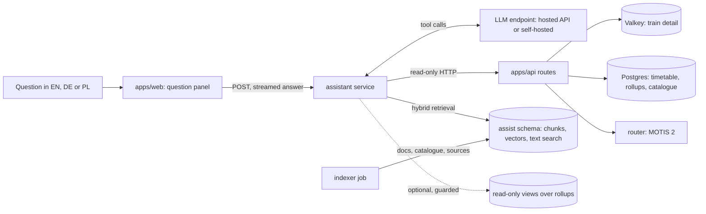
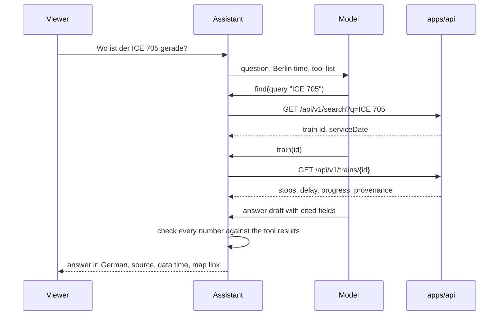

# Natural-language assistant (proposal)

Status: an idea for future work. Nothing proposed here is built. Section 2 lists what the repository already has,
with the file or route for each; everything else is a proposal.

## 1. Summary

A question box next to the map that answers questions about trains in Germany in English, German or Polish, from
GerLines' own data, with a source and a data time on every answer. The core is a tool-calling loop over the existing
read-only HTTP API (`apps/api`): the model chooses which routes to call, the API returns the numbers, and the model
writes them up. Retrieval over an index (RAG) is used only for slow-changing text: the documentation, the catalogue,
the data sources and their licences. An optional third path runs guarded read-only SQL over the statistics rollups
for questions no route answers.

## 2. What already exists to build on

| Need of the assistant | What the repository has | Where |
| --- | --- | --- |
| A typed list of tools | an OpenAPI 3.1 document of every route, built from zod schemas, served at `/api/v1/openapi.json`; a test fails when the app and the document disagree | `apps/api/README.md`, `apps/api/src/search/openapi.test.ts` |
| Live train state | `GET /api/v1/trains/{id}`: every stop with scheduled and predicted times, delays, platforms, progress, vehicle series with confidence, forecast with its basis, and a provenance block (source, attribution, licence, `feedObservedAt`, `predictionChangedAt`) | `packages/schema/src/train-detail.ts` |
| Resolving names to ids | `GET /api/v1/search` (stations, trains, lines of today's timetable, places); a train result's `id` is the trip instance id the train detail takes | `packages/schema/src/search.ts`, `apps/api/src/search/timetable-source.ts` |
| History | `GET /api/v1/stats/today`, `/period`, `/trains/{number}`, `/lines/{line}`, `/stations/{id}`, `/lands/{code}`, `/trains/{number}/segments`, each with a `freshness` block | `docs/statistics.md` |
| Journeys | `GET /api/v1/journeys` (MOTIS 2) and `GET /api/v1/journeys/reliability` (punctuality of up to 30 trains over 30 days) | `apps/api/README.md` |
| Data freshness | `GET /api/v1/status`: per source its newest recorded payload, the newest payload the live engine used, and a state (`ok`, `stale`, `down`, `not_recorded`) | `packages/schema/src/status.ts` |
| Catalogue | 81 vehicle series, 144 operators, 81 transport associations, 9 categories with names in three languages, 198 sources with SPDX licences; every empty field names its reason in `missing` | `catalog/*.yaml`, `catalog/README.md` |
| Per-client limits | rate limits per IPv4 address or IPv6 /64, concurrency gates on statistics and MOTIS | `apps/api/src/limits.ts`, `apps/api/src/client-limit.ts` |
| A read-only database role | `gerlines_api`, prepared in the deploy runbook (step 7, not run anywhere yet) | `docs/runbooks/deploy.md` |

`docs/architecture.md` section 13 already states the intent: every capability is a typed, read-only operation in the
OpenAPI document, so a tool layer can be generated later without new backend work. This proposal builds on that.

## 3. Questions it should answer

| Type | English | Deutsch | Polski | Answered by |
| --- | --- | --- | --- | --- |
| Live | Where is ICE 705 now and how late is it? | Wo ist der ICE 705 gerade und wie viel Verspätung hat er? | Gdzie jest teraz ICE 705 i jakie ma opóźnienie? | search, then train detail |
| History | How punctual was RE1 at Köln Hbf last month? | Wie pünktlich war der RE1 letzten Monat in Köln Hbf? | Jak punktualny był RE1 na stacji Köln Hbf w zeszłym miesiącu? | statistics routes, or the analytical path |
| Journeys | A connection from Leipzig to Kraków tomorrow morning with the most reliable trains. | Eine Verbindung von Leipzig nach Krakau morgen früh mit den zuverlässigsten Zügen. | Połączenie z Lipska do Krakowa jutro rano, najbardziej punktualnymi pociągami. | search, journeys, reliability |
| Catalogue | What is a Class 442? | Was ist die Baureihe 442? | Czym jest seria 442? | catalogue lookup, retrieval |
| Provenance | Where does this delay come from? | Woher kommt diese Verspätungsangabe? | Skąd pochodzi ta informacja o opóźnieniu? | train detail provenance, data status, retrieval over `docs/data-sources.md` |
| Method | How do you count a train as punctual? | Ab wann gilt ein Zug als pünktlich? | Kiedy pociąg uznaje się za punktualny? | retrieval over `docs/statistics.md` |

What each example needs, and where the data stops:

- **Live.** "ICE 705" can match more than one run (today's and the previous service day's, since a run can pass
  midnight), or none. The search answer carries `serviceDate`; the assistant names the run it chose or asks which one.
  "Where" is answered from the train detail's progress (`lastPassedIndex`, `nextIndex`) as "between stop A and stop
  B", never as coordinates: positions are computed in the browser along the matched shape, and the assistant does not
  compute them. It links the map with `?train=<id>`, the deep link the web client already reads
  (`apps/web/src/url/url-state.ts`). A forecast is labelled a forecast with its basis (`feed_plus_spread` or `b1`).
- **History.** No route answers a line at one station. `GET /api/v1/stats/lines/{line}` covers the whole line and
  `/stations/{id}` the whole station. The level-1 rollup `stat_stop` holds day, stop place and line name together
  (`packages/db/migrations/0062_stat_level1.up.sql`), so the analytical path (section 4.3) can answer it. "RE1"
  exists in several regions; the line is resolved through search first. Backfilled days (piebro) have no line and no
  operator (`docs/statistics.md`, Sources and licences), so for such a month the answer is "no line data for this
  period", not a number. Statistics are up to about 40 minutes behind the live map; the answer says so.
- **Journeys.** The router imports the DELFI feed (`services/router/README.md`). A station far outside Germany may not
  be in it; then the journeys route answers `stop_not_found` and the assistant says the planner has no data for that
  stop, and may offer the journey to the last station it holds. "Most reliable" can only mean what the API has today:
  the share of arrivals under 6 minutes late of each train over the last 30 days. Ranking by transfer success is
  planned for a later milestone in `docs/PLAN.md`, so the assistant must not claim it.
- **Catalogue.** `db-442` is the Talent 2 (`catalog/vehicle-series.yaml`). A field the catalogue lists under `missing`
  is said to be missing, with the reason.
- **Provenance.** The train detail names the source the delay came from, its licence and when the feed observed it;
  the data status names how fresh that source is now; `docs/data-sources.md` explains the source.

Out of scope: tickets and prices, seat reservations, anything personal, trains outside the data, predictions beyond
what the forecast table serves, and questions unrelated to trains.

## 4. Architecture



Three paths, chosen per question by the model inside one tool-calling loop:

| Path | Kind | Used for | Why this path |
| --- | --- | --- | --- |
| API tools | tools | live state, search, statistics, journeys, data status | the numbers already exist behind validated, cached, rate-limited routes with provenance |
| Retrieval | RAG | how GerLines works, what a series or operator is, which source has which licence, what a figure means | text that changes with a commit or a catalogue rebuild, not by the minute |
| Analytical | tool with guarded SQL | aggregates no route offers (a line at one station, a comparison of two Länder over hours) | a safety valve; off until the first two paths are measured |

### 4.1 Why live numbers never come from a vector index

An index holds a copy made at indexing time. A delay is valid for seconds to minutes, a platform can change at the
last minute, and a cancelled train must never be reported as running. An embedding of "ICE 705 is 12 minutes late"
would be retrieved as confidently an hour later. The API, in contrast, answers 503 when the live engine has not
confirmed for 30 seconds (`docs/architecture.md`, Train detail). So every number with a time on it comes from a tool
call made for this question, and the indexer refuses any input that is not a committed document or catalogue row.

### 4.2 Tools

Tool definitions are generated from `/api/v1/openapi.json`, then narrowed: fewer parameters, English descriptions
with units, enums instead of free strings. A small set is usually easier for a model to use than one tool per route.

| Tool | Backed by | Notes |
| --- | --- | --- |
| `find` | `GET /api/v1/search` | resolves stations, trains, lines and places; returns ids only the API issued |
| `train` | `GET /api/v1/trains/{id}` | stops, delays, platforms, progress, vehicle, forecast, provenance |
| `station` | `GET /api/v1/stations/{id}` | one station of the search index |
| `stats` | `GET /api/v1/stats/*` | one tool with a `scope` enum (network, Land, station, train, line, segments) and `from`, `to` |
| `journeys` | `GET /api/v1/journeys`, `GET /api/v1/journeys/reliability` | ISO times with an offset; categories and operator filters as the route defines them |
| `data_status` | `GET /api/v1/status` | how fresh each source is |
| `catalog` | new read-only route over the `vehicle_series`, `operator`, `verbund` and `category` tables | exact rows by id or alias; does not exist yet |
| `docs_search` | new hybrid retrieval (section 5) | passages with their file, heading, licence and commit |
| `rollup_query` | new, phase 4 only (section 4.3) | parameterised query templates first, free SQL last |

Dates are resolved by code, not by the model. The system prompt carries the current instant in Europe/Berlin, and
every tool that takes a date validates it; "tomorrow morning" becomes an explicit ISO time the answer repeats, so a
wrong reading is visible. Statistics use Berlin service days (`docs/statistics.md`).



### 4.3 The guarded analytical path

Free text-to-SQL over the whole database is not the core. The tables are large hypertables, the column rules are
subtle (`punctual6` counts arrivals only, backfilled days have no line),
and a plausible wrong query gives a plausible wrong number. The path, when built, is fenced in this order:

1. **Templates first.** Named, reviewed SQL templates with typed parameters (for example "a line at a station over a
   period", over `stat_stop`). The model fills parameters only. Most questions end here.
2. **Free SQL last**, if templates prove too narrow, under all of these:
   - a dedicated role (`gerlines_assist_sql`) with `SELECT` on a small set of views in its own schema, not on the
     tables; the API's prepared role has `SELECT` on every table (`docs/runbooks/deploy.md`, step 7) and is too broad;
   - the views expose the level-2 and level-3 rollups and `stat_stop`, never `stop_event`, `raw_object` or the
     timetable tables;
   - `default_transaction_read_only = on`, `statement_timeout` of a few seconds, a row limit added by the server, a
     parser check that allows one `SELECT` over allowlisted relations and functions only;
   - its own connection pool of one or two connections (the database allows 60 in `infra/compose.yaml`) and a
     concurrency gate like the statistics gate in `apps/api/README.md`;
   - the answer shows the query that produced the number.

## 5. Stores

### 5.1 Options

The corpus is small. The docs folder is a few thousand lines of Markdown, and the catalogue has a few hundred rows.
Chunked, with one card per catalogue row in each language that has a name, it stays in the low thousands of chunks.

| Option | For | Against |
| --- | --- | --- |
| pgvector in the existing Postgres, with full-text search and `pg_trgm` | no new service; one backup; joins to catalogue tables; transactions with the indexer; fits the memory of one server | shares the database's 2 GB memory limit (`infra/compose.yaml`) with the rollups; needs the extension in the image |
| Qdrant (self-hosted) | built-in hybrid search and filtering, fast at large scale | one more container, backup and upgrade path for a corpus that fits in memory many times over |
| OpenSearch | strong BM25 with language analysers, hybrid search | a JVM service with its own memory needs; heavy for this size |
| A managed vector service | no operations | a third party sees the corpus and the queries; monthly cost; conflicts with the single-server plan |

**Recommendation: pgvector inside the existing database.** The compose file runs Postgres 18 with TimescaleDB 2.31
and PostGIS (`timescale/timescaledb-ha:pg18.6-ts2.31.0`; migrations create only `timescaledb` and `postgis`,
`packages/db/migrations/0001_extensions.up.sql`). The timescaledb-ha image line is built to ship pgvector; confirm
it on the pinned digest with `SELECT * FROM pg_available_extensions WHERE name = 'vector'` before relying on it.
`pg_trgm` and `unaccent` are standard contrib extensions. At a few thousand vectors an exact scan may well be fast
enough; add an HNSW index once a measurement says so.

Hybrid retrieval: dense similarity, full-text rank and trigram similarity on titles and aliases, fused by
reciprocal rank fusion, then an optional cross-encoder rerank of the top 20 to 30. The docs are written in English
while questions come in three languages, so the dense part carries the cross-language matching. Postgres ships
German and English text search configurations. Check the running version for a Polish one; without it, Polish text
uses the `simple` configuration plus trigrams.

### 5.2 Schema

A new schema `assist`, in a new migration, owned by the indexer role and read by the assistant role.

```sql
CREATE EXTENSION IF NOT EXISTS vector;
CREATE EXTENSION IF NOT EXISTS pg_trgm;
CREATE SCHEMA assist;

CREATE TABLE assist.corpus_version (
  corpus_version_id bigint GENERATED ALWAYS AS IDENTITY PRIMARY KEY,
  git_commit text NOT NULL,
  embedding_model text NOT NULL,
  embedding_dim int NOT NULL,
  built_at timestamptz NOT NULL DEFAULT now(),
  active boolean NOT NULL DEFAULT false
);
CREATE UNIQUE INDEX corpus_version_one_active ON assist.corpus_version (active) WHERE active;

CREATE TABLE assist.document (
  document_id text NOT NULL,          -- 'docs/statistics.md', 'catalog/vehicle-series.yaml#db-442'
  corpus_version_id bigint NOT NULL REFERENCES assist.corpus_version ON DELETE CASCADE,
  kind text NOT NULL CHECK (kind IN ('doc', 'series', 'operator', 'category', 'verbund', 'source')),
  title text NOT NULL,
  lang text NOT NULL CHECK (lang IN ('en', 'de', 'pl')),
  licence text NOT NULL,              -- SPDX expression, from catalog/sources.yaml or REUSE.toml
  attribution text NOT NULL,
  source_url text,
  content_sha256 bytea NOT NULL,
  PRIMARY KEY (corpus_version_id, document_id, lang)
);

CREATE TABLE assist.chunk (
  chunk_id bigint GENERATED ALWAYS AS IDENTITY PRIMARY KEY,
  corpus_version_id bigint NOT NULL,
  document_id text NOT NULL,
  lang text NOT NULL,
  ordinal int NOT NULL,
  heading_path text NOT NULL,         -- 'Statistics API > Figures'
  body text NOT NULL,
  token_count int NOT NULL,
  embedding vector(1024) NOT NULL,    -- dimension of the chosen model
  tsv tsvector NOT NULL,              -- built by the indexer with german, english or simple
  FOREIGN KEY (corpus_version_id, document_id, lang)
    REFERENCES assist.document ON DELETE CASCADE
);
CREATE INDEX chunk_tsv_idx ON assist.chunk USING gin (tsv);
CREATE INDEX chunk_version_idx ON assist.chunk (corpus_version_id);
-- after measuring: CREATE INDEX chunk_embedding_idx ON assist.chunk USING hnsw (embedding vector_cosine_ops);

CREATE TABLE assist.alias (
  corpus_version_id bigint NOT NULL,
  alias text NOT NULL,                -- 'Talent 2', 'BR 442', 'Class 442', 'seria 442'
  document_id text NOT NULL,
  PRIMARY KEY (corpus_version_id, alias, document_id)
);
CREATE INDEX alias_trgm_idx ON assist.alias USING gin (alias gin_trgm_ops);
```

The indexer builds a new corpus version beside the active one and switches `active` in one transaction, so
readers never see a half-built index. Station facts stay out of the index: stations change with the
weekly timetable and the search index already serves them (`find`, `station`).

### 5.3 Conversations, caching and limits

- **Conversations.** Stored nowhere by default. The browser holds the open conversation in memory and sends the
  last few turns with each question. The project sets no cookies and keeps only preferences in local storage
  (`docs/architecture.md` section 12, `apps/web/src/legal/PrivacyPage.tsx`); a stored chat log would be personal data
  under the GDPR, since people type names, places and travel plans. The server logs counts only: tokens, tool calls,
  latency, error class, corpus version. No question text, no address. An opt-in "report a wrong answer" button may
  store that one exchange for a fixed short period, named on the privacy page with the LLM provider as a processor
  if a hosted API is used.
- **Caching.** Tool results, not answers. The API already caches (train detail 5 s with an ETag, statistics 60 s or
  an hour, journeys reliability 5 minutes). The assistant caches query embeddings and retrieval results per corpus
  version in process memory. A whole answer is cached only for retrieval-only questions, keyed by normalised
  question, language and corpus version. Do not use the shared Valkey for this: it runs with `maxmemory 256mb` and
  `noeviction` (`infra/compose.yaml`), so a growing cache would make the live engine's writes fail.
- **Rate limits.** A new limiter in the API's per-client scheme: a few questions a minute and a daily cap per client,
  a global concurrency gate on model calls, and a global daily token budget that switches the feature off (answer
  503 with `Retry-After`) when spent. Tool calls made by the assistant count against the assistant's budget, not the
  viewer's ordinary API limits. The Cloudflare rule over `/api/` in the deploy runbook remains the outer guard.

## 6. Models

### 6.1 Requirements

- Reliable tool calling with JSON arguments that match a schema, several calls per question.
- Reads and writes German, English and Polish well, including place names with diacritics (Köln, Kraków).
- Low latency: the first words within a few seconds, the full answer streamed.
- A known cost per question within a fixed monthly budget. The published budget for the whole launch is about
  20 EUR a month (`docs/architecture.md` section 14), so the assistant must run under a hard cap or be off.
- Terms compatible with a non-commercial AGPL project and with EU data protection.

Cost per question is about (input tokens times input price plus output tokens times output price) summed over the
loop's turns. Tool results dominate input: a full train detail or journeys answer is large, so the assistant trims
results to the fields the model needs before sending them.

### 6.2 Options

| Family | For | Against |
| --- | --- | --- |
| Hosted LLM API | usually the best tool calling and language quality at low volume; no GPU to run | every question leaves the server; a processor agreement and data transfer terms; cost grows with use; needs an egress route |
| Self-hosted open-weights model (vLLM or llama.cpp server) | data stays on our hardware; no per-token cost | needs a GPU for interactive latency; a GPU server costs far more than the launch budget; smaller models call tools less reliably |

Open-weights families with tool calling and multilingual coverage include Qwen, Mistral, Llama and Gemma. Their
licences differ (some Apache-2.0, some with their own terms and use restrictions); check each before use. The
assistant talks to the model through one small adapter interface (messages, tool definitions, streamed tool calls),
so a deployment chooses the endpoint by configuration and the eval suite (section 8) decides whether a model passes.

### 6.3 Embeddings and reranking

- Multilingual, trained for retrieval, so a German or Polish question finds an English passage.
- Runs on CPU in the indexer and at query time; a few thousand chunks are embedded once per commit.
- The same model and version at indexing and at query time; `assist.corpus_version` records it.
- Examples: `BAAI/bge-m3` (1024 dimensions, MIT licence) or the `intfloat/multilingual-e5` models; a multilingual
  cross-encoder such as `BAAI/bge-reranker-v2-m3` for the optional rerank. Pick by the retrieval eval, not by name.

## 7. Grounding and safety

- **Cite and date every answer.** Each number names the tool result it came from; the answer shows the source with
  its attribution and licence and the data time: `feedObservedAt` for the train detail, `freshness.refreshedAt` and
  the 40-minute note for statistics, the corpus commit for retrieved text. Share-alike text (Wikipedia-derived
  catalogue rows are CC BY-SA 4.0, `catalog/README.md`) is quoted with its attribution.
- **Missing is missing.** A null field, a 404, a 503 or an empty split becomes a plain sentence ("no realtime data
  for this train, timetable times only"), never a guess. The system prompt states this; the checker below enforces it.
- **Check before sending.** After the model writes, code extracts every number, time, platform and train number from
  the draft and matches each to a value in this question's tool results. An unmatched value blocks the answer, which
  is regenerated once and otherwise replaced by the raw tool facts.
- **Prompt injection.** Tool results and passages are data, never instructions. Text that others wrote reaches the
  model through station and operator names from the feeds, quoted Wikipedia evidence in `catalog/fleet-rules.yaml` and
  `catalog/identical-bodies.yaml`, and later service alert texts (`alert_message`, not served by the API today). Wrap
  them in delimiters, strip control characters, cap their length, and give the model no tool that writes, sends or
  fetches arbitrary URLs. Every tool is read-only and accepts only ids the API issued or validated parameters.
- **Limits on tools.** At most a handful of tool calls and two model turns per question; a time budget per question;
  results trimmed to a token limit; at most one journeys call per question, since MOTIS has six slots for everyone.
- **No personal data.** No accounts, no stored conversations by default, no addresses in logs. The model is told not
  to ask for personal data, and questions about people are refused.
- **Cost ceilings and abuse.** Per-client and global limits (section 5.3), a maximum question length, a hard monthly
  token budget with an automatic switch-off, and a kill switch in the environment. Questions outside the scope get a
  short fixed answer without a model call when a cheap classifier is sure.
- **Interface.** The panel follows `DESIGN.md` and the accessibility target in `docs/accessibility.md` (a live
  region for the streamed answer, keyboard focus). The copy lint checks the shipped messages and cannot see generated
  text, so the server applies the same punctuation rules to each answer and the panel labels it as generated.

## 8. Evaluation

Retrieval and generation are measured separately, so a failure points at the layer to fix.

- **Golden set.** 30 to 50 questions per type (live, history, journeys, catalogue, provenance, method, out of
  scope), each in English, German and Polish, plus adversarial ones: an unknown train number, a station abroad, a
  backfilled month, a source that is down, an injected instruction inside a station name, a request for personal data.
- **Frozen tool results.** Live answers cannot be compared with a moving world. Each case stores the tool results it
  was graded against, as the API tests already store MOTIS answers in `apps/api/test/fixtures/`. The run replays them,
  so the grade depends on the model and the prompt only.
- **Deterministic graders first.** Right tools called with valid arguments; every number in the answer present in the
  tool results; a source and a data time present; the stated missing fields said to be missing; the answer in the
  question's language; refusals where expected.
- **Retrieval metrics.** Recall at 5 and mean reciprocal rank against labelled passages per question, per language,
  for dense only, text only and the fused result.
- **Model-graded checks** only for what code cannot judge (clarity, whether the answer addresses the question),
  calibrated against a small human-labelled sample.
- **Gating in CI.** The main CI job runs without a database (`.github/workflows/ci.yml`); a second workflow runs the database tests. The tool schemas, the checker, the SQL
  allowlist and retrieval over a committed fixture corpus run on every change. The full model eval runs when a
  prompt, tool definition, model setting or the indexer changes, and blocks the merge on any drop in pass rate or
  rise in cost per question against the stored baseline.

## 9. Where it runs

### 9.1 Single server (the prepared compose deployment)

The prepared production overlay (`infra/compose.production.yaml`, `docs/runbooks/deploy.md`) puts `api`, `live` and
`centrifugo` on internal networks with no route out; only the recorder joins the `egress` network. The assistant fits
as one more service:

- an `assistant` container (Node 24, Hono, like the API), read-only file system, `cap_drop: ALL`, a memory limit;
- on `front` to reach `api`, on `backend` to read the `assist` schema with its own read-only role, and on `egress`
  only when the model is a hosted API, with the endpoint pinned in configuration;
- the API keeps no route out; its routes are called over the internal network, so the assistant gets the same
  validation, caching and provenance as the browser;
- the edge routes `/api/v1/assist/*` to it, so the existing Cloudflare rule over `/api/` applies; answers stream as
  server-sent events;
- the indexer runs as a one-off job after a deploy or a catalogue rebuild, not while MOTIS imports or other heavy
  jobs run;
- off by default: without a model endpoint and a budget in the environment, the route answers 503 `not_configured`,
  as other API parts do.

A self-hosted model does not fit this server: it would compete with Postgres, MOTIS and the live engine for memory,
and without a GPU the latency would not suit an interactive answer.

### 9.2 Cloud (AWS and others)

- **Database.** Managed Postgres services (on AWS, RDS and Aurora) offer pgvector but not TimescaleDB, which the
  rollups need: keep a self-managed Postgres with both, or use a provider that offers TimescaleDB.
- **Model.** The cloud's managed model service in an EU region, or a GPU instance running vLLM, reached through a
  private endpoint. Model keys in the provider's secret store; egress allowed to the model endpoint only.
- **Assistant.** A stateless container, scaled on request rate, separate from the API so that its cost and
  failures stay isolated. The EU region of the model and the logs is recorded on the privacy page.

## 10. Phased plan

1. **Tool layer.** Generate and narrow the tool definitions from `/api/v1/openapi.json`, add the `catalog` read
   route, and publish the tools as a Model Context Protocol server or a plain tool manifest. Anyone can then ask
   questions with a model of their own choice, at no running cost to the project. Deliverables: tool schemas, the
   number checker as a library, the first golden set with frozen tool results.
2. **Hosted assistant, tools only.** The `assistant` service, the question panel, live, search, statistics, journeys
   and data status. No retrieval. Off by default, behind limits and a monthly budget. Gate: the golden set passes in
   three languages, and every answer carries a source and a data time.
3. **Retrieval.** The `assist` schema, the indexer over `docs/` and `catalog/`, hybrid search, optional rerank,
   retrieval metrics in CI.
4. **Analytical path.** Reviewed SQL templates over the rollups first; free SQL behind the fences of section 4.3
   only if templates leave common questions unanswered.

## 11. Open questions

- Is a hosted LLM API acceptable for a project that sets no cookies, and under which data processing terms? If not,
  phase 1 (tools for the viewer's own model) may be the whole feature.
- Who pays, how much a month, and what happens when the budget is spent mid-month?
- Does the pinned timescaledb-ha image carry pgvector, and at which version?
- Should catalogue cards in German and Polish be generated from the English rows, and who reviews them? The German
  and Polish category names still wait for review (`catalog/README.md`).
- Which line name format do viewers type ("RE1", "RE 1"), and how does `find` map it to the timetable's line names?
- How should the assistant answer while the live engine is down: refuse live questions, or answer from the timetable
  with a clear label?
- Is a Model Context Protocol server of the public API wanted on its own, before any hosted assistant?
