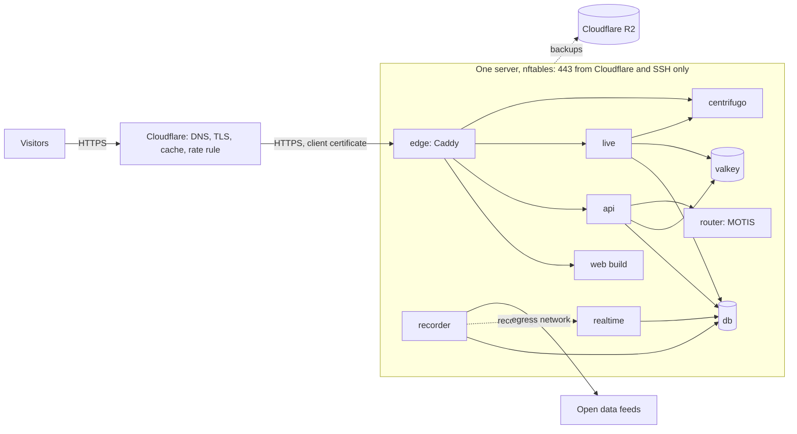
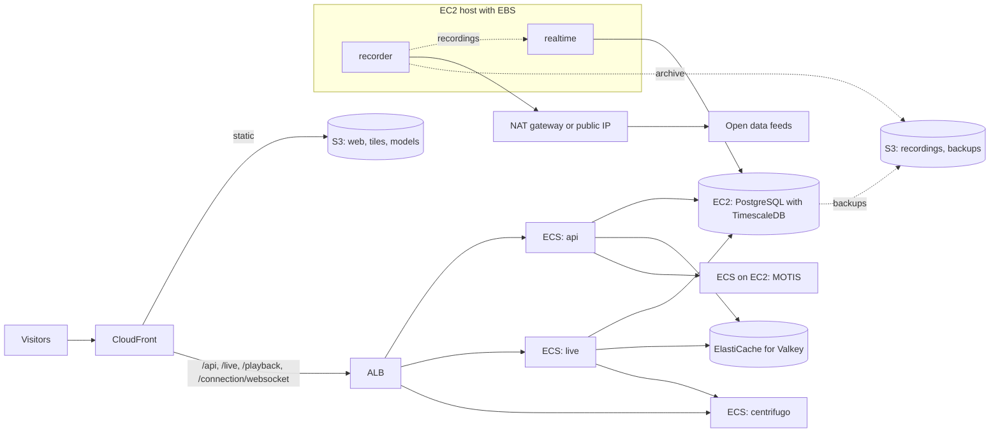

# Deployment options

GerLines is not deployed anywhere yet. This document compares realistic ways to run it as a public service and
recommends one. The constraints are those of the project: AGPL-3.0, non-commercial, one maintainer, a hobby budget
(about 20 EUR a month at launch, [architecture.md](architecture.md) section 14).

The repository prepares one path in detail: one server behind Cloudflare, with a hardened Docker Compose overlay
([infra/compose.production.yaml](../infra/compose.production.yaml), [infra/production/](../infra/production/),
[runbooks/deploy.md](runbooks/deploy.md), checked by `bash scripts/check-deploy.sh`). The other options below are
not prepared in the repository.

Prices are orders of magnitude, estimated in November 2026, without VAT. They change often. Check the provider's
pricing page before deciding: [Hetzner Cloud](https://www.hetzner.com/cloud/), [Cloudflare plans](https://www.cloudflare.com/plans/),
[Cloudflare R2](https://developers.cloudflare.com/r2/pricing/), [AWS pricing calculator](https://calculator.aws/),
[Tiger Cloud (managed TimescaleDB)](https://www.tigerdata.com/pricing).

## 1. What has to run

Taken from [infra/compose.yaml](../infra/compose.yaml) and the production overlay. Memory limits are the ones in the
Compose files. They were sized for a 16 GB laptop ([infra/README.md](../infra/README.md), Resource limits) and the
runbook says to revisit them for a server.

| Component | Compose service | Kind | State | Memory in the repo |
| --- | --- | --- | --- | --- |
| PostgreSQL 18 with TimescaleDB 2.31 and PostGIS 3.6 (`timescale/timescaledb-ha` image) | `db` | always on | stateful: timetable, stop events, forecasts, rollups | limit 2 GB, `shared_buffers` 512 MB |
| Valkey 9 | `valkey` | always on | train details with a TTL, append-only file and snapshots; rebuilt by `live` | limit 512 MB, `maxmemory` 256 MB, `noeviction` |
| Centrifugo 6 (WebSocket push of frame notices) | `centrifugo` | always on | none (in-memory engine) | 512 MB in the overlay; 148 MiB measured at 3,000 clients on the laptop |
| Recorder (`services/ingest`) | `recorder` | always on, single process per data folder | stateful files in `RECORDINGS_DIR`, index in the database | 1 GB |
| Realtime processor (`services/ingest`) | `realtime` | always on, the only writer | checkpoint in `REALTIME_STATE_DIR`; reads the recordings | heap 1.5 GB, container 2.5 GB |
| Live engine (`services/live`) | `live` | always on, one instance | frames and shape packs in `LIVE_DIR` | 768 MB |
| Journey router (MOTIS 2) | `router` | always on, read-only data folder | imported data in `ROUTER_RUN_DIR` | 3 GiB; peak 2,391 MiB under 8 parallel clients, about 1.5 GiB idle ([services/router/README.md](../services/router/README.md)) |
| API (`apps/api`) | `api` (overlay only) | always on, stateless | none; reads `API_DATA_DIR` | 1.5 GB; about 470 MB more with the forecast table |
| Edge (Caddy) | `edge` (overlay only) | always on | TLS material in `EDGE_TLS_DIR` | 256 MB |
| Web client (`apps/web` build, with the 3D train models under `/trains/`) | served by `edge` | static files | none | n/a |

The sum of these limits is about 12 GB. On a 16 GB server that leaves little for the operating system, the page
cache and any batch job.

Batch jobs are not Compose services. They run by hand or on a schedule:

| Job | When | Load, as the repo states it |
| --- | --- | --- |
| Timetable import (`pipelines/static_import`) | weekly | DELFI GTFS of about 515 MB; validating the full feed needs more than a 9 GiB JVM heap ([architecture.md](architecture.md) section 6) |
| Rail graph and shape matching (`pipelines/rail_graph`, pfaedle over the OSM rail graph) | weekly or on timetable change | heavy; the steps refuse to start below 40 % free memory ([pipelines/rail_graph/README.md](../pipelines/rail_graph/README.md)) |
| Shape packs (`live packs build`) | per timetable version and shape epoch | about 10 minutes for a national timetable ([infra/README.md](../infra/README.md)) |
| MOTIS import (`services/router/scripts/import.sh`) | per timetable version | several GB of memory and disk; the full street-routing import was never measured |
| Playback render (`live playback render`) | hourly, niced | a separate process with a byte budget; not wired into the overlay (no `LIVE_PLAYBACK_DIR`) |
| Rollup refresh | every 30 minutes | runs inside the database as TimescaleDB jobs |

Measured on the development machine (approximate):

- The recorder stores about 4 to 5 GB of raw feed recordings per weekday and downloads roughly 2 GB per hour
  (measured on the development machine; about 1.5 TB a month inbound). Retention keeps 3 days plus marked days on disk.
- Realtime processing writes about 2.6 GB of rows a day, of which about 0.45 GB stay after compression
  ([history.md](history.md)).
- A national render follows about 2,900 trains at a weekday peak (architecture section 11).
- A local push test held 3,000 WebSocket clients.
- A browser's first load takes about 11.7 MB of shape packs, 1.6 MB of static files and 74 KB of frames; after that
  a client uses about 34 KB a minute of heads, deltas and push notices, plus about 90 to 190 KB a minute of shape
  packs in the first ten minutes ([architecture.md](architecture.md) section 11).

Map tiles are not served by GerLines today. The browser loads the basemap and glyphs from OpenFreeMap, satellite
imagery from VersaTiles and terrain from Mapterhorn (`apps/web/src/map/style/build-style.ts`). Self-hosting them as
PMTiles is planned for the deployment milestone ([PLAN.md](PLAN.md)). The Mapterhorn terrain for the Germany box at
zoom 12 is about 1.07 GB ([pipelines/rail_graph/README.md](../pipelines/rail_graph/README.md)).

Two constraints shape every option:

- **Single writers.** The recorder, the realtime processor and the live engine each run as one instance. They do not
  scale out by adding replicas.
- **Shared files.** The recorder writes `RECORDINGS_DIR` and the realtime processor reads it. `live packs build`
  writes `LIVE_DIR` and the live engine serves it. Each pair needs the same file system, which is easy on one host and
  costly on a serverless container platform.

## 2. Option A: one server behind a CDN (the prepared path)

The shape of [runbooks/deploy.md](runbooks/deploy.md): one Hetzner Cloud server (the runbook names a CX43 with
16 GB) running the Compose stack, Cloudflare in front for DNS, TLS, caching and one rate limiting rule, and Cloudflare
R2 for backups and archives ([architecture.md](architecture.md) section 14).

What the repository already provides:

- Only the edge publishes a port (443). The database, Valkey, Centrifugo, live and MOTIS have no published port and
  sit on internal networks without a route out. Apart from the edge, only the recorder can reach the internet (the
  `egress` network).
- Every secret is required (`${VAR:?}`); `check-deploy.sh` fails on defaults, placeholders, dev flags and unpinned
  images. The runbook records a last run of 39 checks passing on a laptop.
- Cloudflare is the only trusted proxy. Per-hostname Authenticated Origin Pulls with the project's own CA make the
  origin refuse other Cloudflare zones. An nftables firewall admits 443 from Cloudflare ranges and SSH from named
  addresses (`infra/production/firewall.sh`, with a 60 s rollback).
- Immutable objects (frames, shape packs, `/assets/*`) carry long cache lifetimes, so the CDN serves most bytes and
  the origin sees each object about once per data centre.

Strengths:

- Lowest cost: a 16 GB cloud server is in the order of 15 to 20 EUR a month, Cloudflare Free costs nothing, and R2
  has no egress fees. Hetzner bills outbound traffic only and includes a large monthly allowance, so the recorder's
  1.5 TB of downloads costs nothing extra (check the current terms).
- One host means the shared folders, the single writers and the batch jobs need no extra design.
- The Compose files run unchanged on any Linux host with Docker Engine and Compose 2.24 or newer, so the lock-in is
  small. The Cloudflare-specific parts are the origin pull CA, the IP ranges and the rate limiting rule.
- Data stays in the EU at the origin (Hetzner locations in Germany and Finland).

Limits:

- One host is one failure domain. A server or disk failure stops the map until a restore. The recorder misses data
  while it is down, and only DELFI can be refilled from the mirror's archive.
- Memory is tight. The laptop limits add up to about 12 GB. A full validator run or a pfaedle run cannot share a
  16 GB host with the serving stack. A larger cloud server (32 GB) is in the order of 30 to 40 EUR a month.
- Disk is the first resource to run out. About 2.6 GB a day pass through the database's rowstore and about 0.45 GB a day stay
  after compression, about 14 GB a month ([history.md](history.md)); a month's rollup refresh peaks at about 10 GB. The
  recordings take 15 to 20 GB at any time. Plan for an attached volume or a larger disk, and watch the recorder's disk
  floor (`RECORDER_DISK_FLOOR_GIB`, default 20).
- Cloudflare Free allows one rate limiting rule, counted per data centre ([runbooks/deploy.md](runbooks/deploy.md)
  section 5). Requests for objects that do not exist miss the cache and are not limited at the edge.

Not yet tested, according to the repository:

- No server, DNS record, Cloudflare zone or firewall on a host exists. The firewall rules were checked with `nft -c`
  and in a container network namespace only.
- The API image (`infra/production/api.Dockerfile`) has not been built. No image has been scanned.
- The read-only database role for the API (SQL in runbook step 7) has not been run. Live, recorder and realtime still
  use the owner role.
- The Content-Security-Policy is in Report-Only mode.
- The memory limits, log rotation (only `realtime` sets it), backups and monitoring are open items in runbook
  section 7.
- The start steps in runbook section 4 start `recorder`, `router`, `centrifugo`, `live`, `api` and `edge`, but not
  `realtime`, although step 6 builds it. Without it the live map has no realtime delays.
- Playback is routed by the edge (`/playback/v1/*`) but the overlay sets no `LIVE_PLAYBACK_DIR` and runs no render job.
- The text is not consistent on push connections: `infra/production/centrifugo.json` allows anonymous connections
  and anonymous subscriptions to the `live` namespace, as runbook section 2 and architecture section 7 describe, while
  runbook section 6, the last item of runbook section 7, `infra/README.md` and `production.env.example` still say
  token-only connect. Runbook section 7 also says the web client has no Centrifugo client, but
  `apps/web/src/live/push-channel.ts` is one. The config file is what runs.
- Push fan-out, API latency and live traffic were measured on the laptop, not on a server.

## 3. Option B: AWS

A mapping that keeps the code as it is. AWS is a reasonable platform for this stack, but the managed database does
not fit and the managed version of every other part costs more than the whole of option A.

### The database catch: TimescaleDB is not available on RDS or Aurora

Amazon RDS for PostgreSQL and Aurora PostgreSQL do not offer the TimescaleDB extension. It is not on the RDS
extension list ([RDS extension versions](https://docs.aws.amazon.com/AmazonRDS/latest/PostgreSQLReleaseNotes/postgresql-extensions.html)).
The likely reason is the licence: TimescaleDB ships as an Apache-2.0 edition and a community edition under the Timescale
License (TSL), and the TSL does not allow a cloud provider to offer the community edition as a database service
([TimescaleDB editions](https://www.tigerdata.com/docs/about/latest/timescaledb-editions)). The Apache-2.0 edition
lacks continuous aggregates and compression.

GerLines needs the community edition. The migrations in `packages/db/migrations` create hypertables, continuous
aggregates for the statistics rollups and columnstore (compressed) chunks for older data. The TSL allows running the
community edition yourself for your own service, which is what the Compose stack does.

The choices on AWS are:

1. **Self-managed PostgreSQL on EC2** with the same `timescale/timescaledb-ha` image, an EBS gp3 volume and backups
   to S3 (for example with pgBackRest or WAL-G). This keeps the code and the migrations unchanged. Upgrades,
   failover and restore tests are yours. It is the realistic choice.
2. **Tiger Cloud**, Timescale's own managed service, which runs on AWS and offers EU regions. It removes database
   operations but adds a separate bill in the order of tens to hundreds of USD a month for the needed size. The
   PostGIS extension and the migration tooling would need a check against it.
3. **Replace hypertables** with native partitioning (for example `pg_partman`, which RDS supports) and the continuous
   aggregates with scheduled refreshes of ordinary tables. That rewrites the storage and rollup layer, which the
   repository validates against DB's published punctuality. Not worth it for a hosting choice.

### Mapping of the other components

| Component | AWS service | Notes |
| --- | --- | --- |
| api, centrifugo | ECS on Fargate | stateless; the ALB passes WebSockets, keep its idle timeout above Centrifugo's ping interval |
| live | ECS on EC2, one task | serves frames and packs from `LIVE_DIR`, which `packs build` writes; Fargate would need EFS for that folder. Packs could move to S3 behind CloudFront, which changes how they are published |
| router (MOTIS) | ECS on EC2 or Fargate with 4 GB or more | read-only data folder; ship it in the image or on EFS |
| recorder, realtime | one EC2 instance with EBS, both containers on it | they share `RECORDINGS_DIR`; EFS works but adds throughput cost for 4 to 5 GB a day |
| Valkey | ElastiCache for Valkey, smallest node | the data is small (256 MB limit); a container next to `live` is cheaper |
| Web client, 3D models, tiles, terrain | S3 behind CloudFront | the PMTiles archives work from S3 with range requests |
| Recordings archive, backups | S3, with lifecycle rules to cheaper classes | about 140 GB of new recordings a month if all are kept |
| Batch jobs | a short-lived large EC2 instance (32 to 64 GB), started by hand or by a scheduled task | spot instances fit, since the jobs can be rerun |
| Secrets | Secrets Manager or SSM Parameter Store, injected into ECS task definitions | replaces the env file |
| Edge rules | CloudFront cache behaviours, AWS WAF rate-based rule | WAF has a monthly base fee per web ACL and rule |

### Data transfer on AWS

- **Recorder.** Inbound internet traffic is free on AWS, but the recorder's roughly 1.5 TB a month passes a NAT
  gateway if it runs in a private subnet. A NAT gateway charges per hour and per GB processed, which at this volume is
  in the order of 100 USD a month. Running the recorder host in a public subnet with a public IPv4 address (charged
  per hour) avoids the processing fee.
- **Serving.** Traffic out of CloudFront is charged per GB after a free monthly allowance (1 TB in the always-free
  tier at the time of writing). A first page load moves about 13 MB, mostly shape packs. At 1,000 visitors a day that
  is in the order of 400 GB a month, inside the free allowance; growth beyond it costs in the order of 0.1 USD per GB.
  Cloudflare and R2 charge nothing per GB for the same traffic. Traffic between Availability Zones is also charged,
  so keep the services in one zone.

### Cost and fit

A fully managed layout (Fargate tasks, an EC2 database, ElastiCache, ALB, NAT gateway, WAF, CloudFront) is in the
order of 300 to 700 USD a month on demand in `eu-central-1` (Frankfurt). A minimal AWS layout, one EC2 instance with
32 GB running the same Compose stack behind CloudFront, is in the order of 100 to 250 USD a month, less with a savings
plan. Both are well above the project's budget. AWS fits if the project receives credits or a sponsor, or if a
managed, multi-zone setup becomes a requirement.

## 4. Option C: other routes

**A small managed container platform** (for example Fly.io, Render, Railway, Scaleway Serverless Containers). These
run the stateless parts well: the API, Centrifugo and the web build. They fit the rest less well. The recorder and the
realtime processor share files and must run as single instances, and the live engine serves a large pack folder.
Managed PostgreSQL on these platforms rarely includes the TSL edition of TimescaleDB, so the database would run as a
container on a volume, which brings back the operations work without the price of a plain server. Memory costs more
per GB than on a rented server. Worth a look only for the stateless front, combined with a server for the rest.

**A Kubernetes cluster** (k3s on rented servers, or a managed cluster such as Scaleway Kapsule or OVHcloud Managed
Kubernetes, which have EU regions). It gives rolling updates, self-healing and a path to several app nodes. For one
maintainer the cost is the operations load: manifests or charts for every service, persistent volumes for the
database and the shared folders, an ingress with WebSockets, certificate handling and cluster upgrades. Three of the
always-on services are single writers and gain nothing from replicas. Kubernetes becomes useful at stage 3 of
[architecture.md](architecture.md) section 14 (several stateless app nodes), not before.

**A split: batch jobs elsewhere, only the serving path always on.** The weekly jobs need the most memory for the
shortest time: the full GTFS validation (more than 9 GiB of heap), pfaedle over the OSM rail graph and the MOTIS
import. Run them on the maintainer's own machine or on a short-lived 32 to 64 GB cloud server billed by the hour, then
copy the results to the serving host (the MOTIS data folder, the shape packs, the enriched GTFS). The always-on server
then needs only the memory of section 1. Two cautions from the repository:

- The timetable load and the shape epoch live in the production database. A batch host must write to that database
  (over an SSH tunnel, never a published port) or produce a dump to load, and `packs build` must read the same
  `shape_registry` as the live engine ([development.md](development.md), Shape epochs and packs).
- A MOTIS data folder imported on one architecture loaded unchanged in a Linux arm64 container
  ([services/router/README.md](../services/router/README.md)); check the same for the server's architecture.

A short-lived server of this size for a few hours a week costs in the order of a few EUR a month.

## 5. Comparison and recommendation

| Option | Monthly cost (order of magnitude) | Operations effort | Fit for a hobby project | Lock-in | EU data location |
| --- | --- | --- | --- | --- | --- |
| A: one server and Cloudflare (prepared) | 15 to 40 EUR | low to moderate | good | low; Cloudflare parts are replaceable | origin in DE or FI; Cloudflare edge is global, US company |
| A with batch jobs split out | A plus a few EUR | moderate (copy steps) | good | low | as A |
| B: AWS, managed services | 300 to 700 USD | high | poor | high (ECS, IAM, CloudFront, WAF) | `eu-central-1` Frankfurt |
| B: AWS, one EC2 host with Compose | 100 to 250 USD | moderate | fair if credits exist | low to moderate | `eu-central-1` Frankfurt |
| C: managed container platform | 50 to 200 USD | moderate | fair for the stateless front only | moderate | depends on the region chosen |
| C: Kubernetes | 50 to 150 EUR self-managed on rented servers | high | poor at this size | low | EU providers available |

**Recommendation now.** Use option A as prepared: one Hetzner server with 16 GB, which holds the stack only with the
journey router in its reduced configuration (architecture section 14), or 32 GB if the stack does not fit on the real host, Cloudflare Free in front and R2 for backups and archives. Run the weekly heavy jobs on the
maintainer's machine or a short-lived hourly server, not on the serving host. Before launch, close the items in
section 2 that are not yet tested, above all the API image, the read-only role, the `realtime` start, the backups
with one restore, and the legal pages of section 6.

**If traffic grows.** The CDN already absorbs the static and immutable bytes, so growth first shows in API reads,
WebSocket connections and the database. Follow the stages of [architecture.md](architecture.md) section 14: move the
database to its own server with a read replica for statistics, run Centrifugo with the Valkey broker so several
Centrifugo nodes share channels, then add stateless API nodes while the recorder, the realtime processor and the live
engine stay single instances. A paid Cloudflare plan adds rate limiting rules before any of this is needed. AWS or
Kubernetes become worth their cost only with a sponsor, credits or a team.

## 6. Cross-cutting items

**Backups and restore.** The database is the only store that cannot be rebuilt from public sources. The rollups are
rebuildable from the source tables, so backups cover the source tables ([architecture.md](architecture.md)
section 4). Take a nightly `pg_dump` or a base backup with WAL archiving to object storage (R2 or S3) in another
location, encrypted, with a retention of a few weeks. Keep the recordings archive separately; the recorder's
retention deletes only what a public archive or the database still holds (`services/ingest/README.md`). The plan asks
for a restore drill before going public: restore into a fresh database, run the migrations' status check and the
realtime `check` command, and write down the time it took.

**Secrets.** The overlay reads `/etc/gerlines/production.env` (mode 600, outside the repository) and requires every
secret. SOPS files are planned ([architecture.md](architecture.md) section 12). The Mobilithek client certificate is
mounted read-only from `secrets/mobilithek`. Provider keys pass `bash scripts/check-keys.sh` before use
([KEYS.md](KEYS.md)). Rotate the Valkey, Centrifugo and database passwords on a schedule; renew the origin pull
client certificate before it expires (730 days in the runbook).

**Observability.** Today there are health checks per container, `GET /api/v1/status` for source freshness and the
recorder's own status command; Centrifugo's Prometheus endpoint is off. Add at least: external uptime checks on
`/api/health` and `/live/v1/head` through the CDN, an alert when the head stops advancing or a source is down for an
hour, disk usage alerts below the recorder's floor, and container log rotation. A small Prometheus and Grafana pair
or a hosted free tier is enough at this size. Keep logs free of client addresses, as the edge does now.

**AGPL source offer.** The AGPL requires a public service that runs a modified version to offer its users the
corresponding source. Link the public repository and the deployed commit from the site, for example on the credits
page, and show the commit in the health answer. The web app does not link to its source
repository yet.

**Legal pages.** A site aimed at a German audience needs an Impressum (provider identification under § 5 of the
Digitale-Dienste-Gesetz, DDG); treat it as required even for a non-commercial project and have the text checked. The
web client has an Impressum shell whose fields are marked missing and a privacy policy draft
(`apps/web/src/legal/`). Before launch: fill both, name the hosting provider and Cloudflare as processors with data
processing agreements, and keep the privacy page's list of third-party hosts (basemap, satellite and terrain tiles)
in line with what the site loads.

**Licence attribution of the data.** Every source has a licence and an attribution text
([data-sources.md](data-sources.md), [NOTICE.md](../NOTICE.md)). The map shows the sources of the current style.
Data the site publishes that derives from share-alike sources keeps their licence: the shape packs derive from
OpenStreetMap (ODbL), and the realtime data from DELFI and some regional feeds is CC BY-SA. Self-hosted tiles carry the
attribution of their sources.

**Rate limits of upstream providers.** The recorder follows each provider's limits with a token bucket, conditional
requests, backoff and `Retry-After` ([architecture.md](architecture.md) section 5). Known limits include 60 calls a
minute for DB Timetables and for VBB, and five calls a minute for the Swiss GTFS-RT feed
([data-sources.md](data-sources.md)). Every outbound request names `APP_NAME` and `APP_CONTACT` in its headers, and
the production overlay requires both. The DELFI community mirror is run by volunteers; the de-incremented feed is 20
to 42 MB per fetch, so prefer the official Mobilithek delivery in production and keep the mirror as the fallback.
Transitous is for development only and is not used by the production stack. Only one recorder may fetch per data
folder; a second deployment (staging) must not run its own recorder against the same providers without need.
